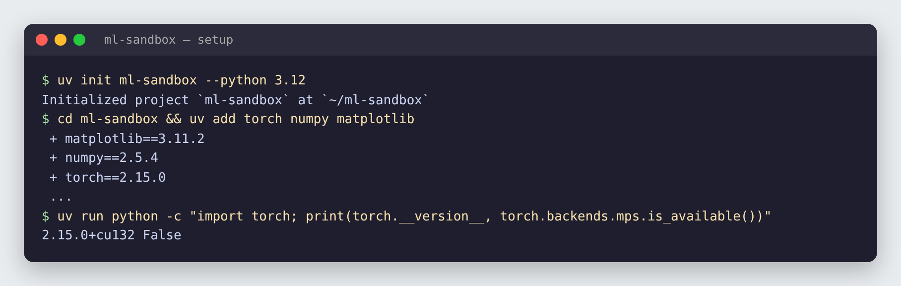
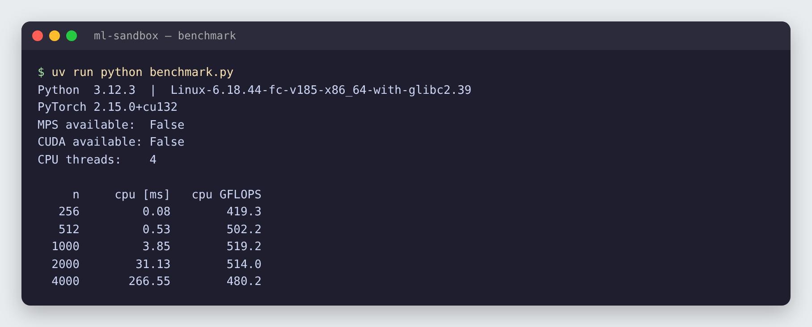
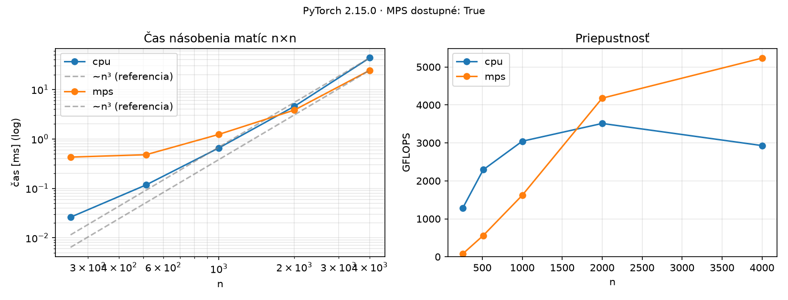

# 01 · Setup & matmul benchmark

🇸🇰 [Slovenská verzia](README.sk.md)

## TL;DR
A reproducible Python ML environment managed with `uv`, plus a benchmark that checks which PyTorch backends are available (CPU, Apple MPS, NVIDIA CUDA) and how fast each one multiplies matrices. On a 4-thread x86 CPU, PyTorch sustains **~500 GFLOPS** and the runtime grows as **O(n³)**, exactly as theory predicts.

> The published numbers come from a 4-thread Linux CPU sandbox with no GPU, so MPS shows as `False`. Running the same script on an Apple Silicon Mac adds an `mps` column to the table and the plot automatically.

## Problem
Every later project in this repo (autograd, GPT from scratch, LoRA fine-tuning, RAG) depends on two things:
1. an environment that installs the same way on any machine, and
2. knowing whether training actually runs on the GPU, and how much faster it is.

Matrix multiplication is the right thing to measure: a linear layer, attention (`Q @ Kᵀ`, `scores @ V`) and an MLP block are all matmuls, and they take most of the compute in a neural network.

## Setup


```bash
uv init ml-sandbox --python 3.12
cd ml-sandbox
uv add torch numpy matplotlib
uv run python -c "import torch; print(torch.__version__, torch.backends.mps.is_available())"
```

What each piece does:

| Tool / file | Role |
|---|---|
| `uv` | Installs Python itself and the packages, creates `.venv/` for this project only. Much faster than pip. |
| `.python-version` | Pins Python 3.12 for this project. |
| `pyproject.toml` | Lists the direct dependencies (`torch`, `numpy`, `matplotlib`). |
| `uv.lock` | Pins the exact version of **every** package, including transitive ones. `uv sync` on another machine recreates the identical environment. |
| `uv run …` | Runs a command inside the project's `.venv` without activating it manually. |

## How it works

### 1. Detecting devices
```python
devices = ["cpu"]
if torch.backends.mps.is_available():   # Apple Silicon GPU (Metal Performance Shaders)
    devices.append("mps")
if torch.cuda.is_available():           # NVIDIA GPU
    devices.append("cuda")
```
PyTorch puts every tensor on a *device*. The same code runs anywhere: you only change `device=`. On a Mac, MPS is the GPU backend; CUDA is the NVIDIA one used on Colab/Kaggle.

### 2. Timing one matrix multiplication
```python
a = torch.randn(n, n, device=device)
b = torch.randn(n, n, device=device)
a @ b                 # warm-up
sync(device)
for _ in range(repeats):
    start = time.perf_counter()
    a @ b
    sync(device)
    times.append(time.perf_counter() - start)
return median(times)
```
Three measurement pitfalls the code avoids:

- **Warm-up.** The first call allocates memory and prepares GPU kernels. It is always slower and would distort the result, so it is run once and not timed.
- **Synchronization.** On a GPU, `a @ b` returns immediately and the work runs asynchronously in the background. Without `torch.mps.synchronize()` (or `torch.cuda.synchronize()`) the timer would only measure how long it took to *queue* the work, and the GPU would look impossibly fast. On CPU, `sync` does nothing because the CPU computes synchronously.
- **Median of 5 runs.** Single measurements are noisy (other processes, CPU frequency changes). The median ignores outliers better than the mean.

### 3. From time to GFLOPS
```python
gflops = 2 * n**3 / t / 1e9
```
Each of the n² output cells is a dot product of length n: n multiplications and n additions. That gives n² · 2n = **2n³** floating-point operations (FLOPs). Dividing by the time gives FLOPs per second; `1e9` turns that into GFLOPS. This makes different matrix sizes and different devices directly comparable.

### 4. Outputs
- `benchmark.py` prints the table and saves the raw numbers to `results.json`.
- `plot.py` reads `results.json` and draws `assets/matmul_benchmark.png`. Separating measurement and plotting means you can restyle a chart without rerunning the benchmark.

```
benchmark.py ──► results.json ──► plot.py ──► assets/matmul_benchmark.png
      └──► table in the terminal
```

## Results


| n | CPU time [ms] | CPU GFLOPS |
|---:|---:|---:|
| 256 | 0.08 | 419 |
| 512 | 0.53 | 502 |
| 1000 | 3.85 | 519 |
| 2000 | 31.13 | 514 |
| 4000 | 266.55 | 480 |



**How to read the plots**
- **Left (log-log):** on logarithmic axes a power law `t ∝ nᵏ` becomes a straight line with slope k. The measured points lie on the dashed `n³` reference line, so doubling `n` makes the multiplication ~8× slower (3.85 ms → 31.13 ms → 266.55 ms).
- **Right:** throughput is lower for small matrices (n = 256) because fixed overhead dominates and the CPU cores are not fully busy. It peaks around n = 1000–2000 and drops slightly at 4000, where the three matrices (3 × 64 MB) no longer fit in the CPU cache and data has to come from slower RAM.

**Why this matters later:** attention compares every token with every other token, so its cost grows with the square of the context length. Model size and context length multiply the cost, which is why KV cache, quantization and batching (projects P4 and P10) exist.

## 🏎️ On the cars

200 cars, each with its own small neural network brain. Computing all brains in **one batched matmul** instead of a Python loop over cars gives the same steering **21× faster** (0.73 ms → 0.034 ms for 200 cars). Same lesson as this step: batch the work, then measure it.


Full chapter: [Racing Lab · ch. 01](../05-racing-lab/README.md#ch-01--batching-200-brains-in-one-matmul) · code: [`chapters/ch01_batch.py`](../05-racing-lab/chapters/ch01_batch.py)

## What I learned
- `uv` + a lockfile make every project reproducible with one command.
- How to detect accelerators in PyTorch and move tensors between devices.
- How to time GPU code correctly: warm-up, synchronize, median.
- Matrix multiplication is O(n³), and GFLOPS normalizes speed so devices can be compared.

## Run it
```bash
uv sync                      # create .venv from uv.lock
uv run python benchmark.py   # print the table, write results.json
uv run python plot.py        # write assets/matmul_benchmark.png
```

## Limitations
- The published numbers are CPU-only. MPS numbers still need to be measured on an Apple Silicon Mac.
- float32 only; float16/bfloat16 would be faster on GPUs.
- One operation (square matmul) is not a full training benchmark.
