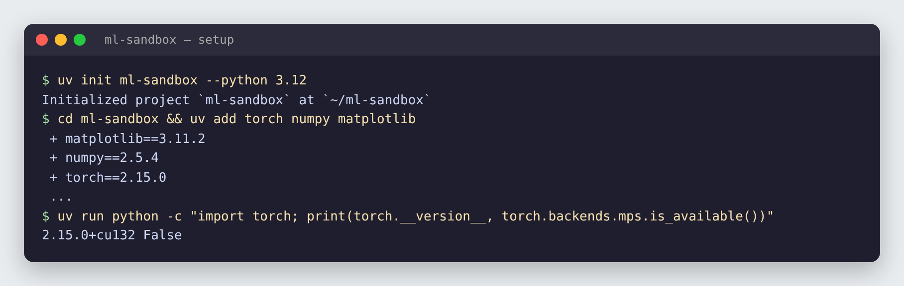
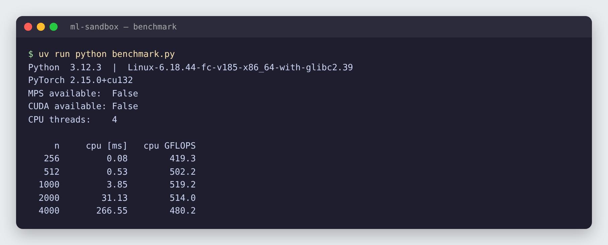
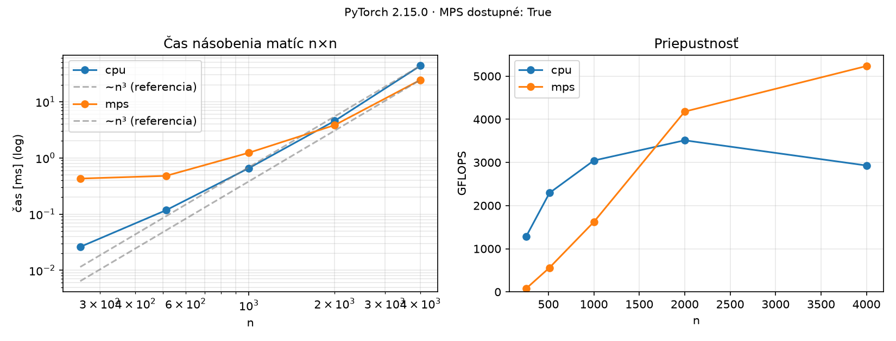

# 01 · Setup a benchmark násobenia matíc

🇬🇧 [English version](README.md)

## TL;DR
Reprodukovateľné Python ML prostredie spravované cez `uv` a benchmark, ktorý zistí, ktoré backendy PyTorch sú dostupné (CPU, Apple MPS, NVIDIA CUDA), a ako rýchlo každý z nich násobí matice. Na 4-vláknovom x86 CPU dosahuje PyTorch **~500 GFLOPS** a čas rastie ako **O(n³)**, presne podľa teórie.

> Zverejnené čísla sú z 4-vláknového linuxového CPU bez GPU, preto je MPS `False`. Ten istý skript na Macu s Apple Silicon automaticky pridá stĺpec `mps` do tabuľky aj grafu.

## Problém
Každý ďalší projekt v tomto repe (autograd, GPT od nuly, LoRA fine-tuning, RAG) stojí na dvoch veciach:
1. prostredie, ktoré sa na každom stroji nainštaluje rovnako, a
2. vedieť, či tréning naozaj beží na GPU a o koľko je rýchlejší.

Násobenie matíc je správna vec na meranie: lineárna vrstva, attention (`Q @ Kᵀ`, `scores @ V`) aj MLP blok sú násobenia matíc a tvoria väčšinu výpočtu v neurónovej sieti.

## Setup


```bash
uv init ml-sandbox --python 3.12
cd ml-sandbox
uv add torch numpy matplotlib
uv run python -c "import torch; print(torch.__version__, torch.backends.mps.is_available())"
```

Čo robí ktorá časť:

| Nástroj / súbor | Úloha |
|---|---|
| `uv` | Nainštaluje samotný Python aj balíky a vytvorí `.venv/` len pre tento projekt. Oveľa rýchlejší ako pip. |
| `.python-version` | Zamkne Python 3.12 pre tento projekt. |
| `pyproject.toml` | Zoznam priamych závislostí (`torch`, `numpy`, `matplotlib`). |
| `uv.lock` | Zamkne presnú verziu **každého** balíka vrátane tranzitívnych. `uv sync` na inom stroji vytvorí identické prostredie. |
| `uv run …` | Spustí príkaz v `.venv` projektu bez ručnej aktivácie. |

## Ako to funguje

### 1. Zistenie zariadení
```python
devices = ["cpu"]
if torch.backends.mps.is_available():   # GPU na Apple Silicon (Metal Performance Shaders)
    devices.append("mps")
if torch.cuda.is_available():           # NVIDIA GPU
    devices.append("cuda")
```
PyTorch dáva každý tenzor na nejaké *zariadenie* (device). Ten istý kód beží všade, meníš len `device=`. Na Macu je GPU backend MPS, CUDA je NVIDIA backend, ktorý používajú Colab a Kaggle.

### 2. Meranie jedného násobenia
```python
a = torch.randn(n, n, device=device)
b = torch.randn(n, n, device=device)
a @ b                 # zahriatie (warm-up)
sync(device)
for _ in range(repeats):
    start = time.perf_counter()
    a @ b
    sync(device)
    times.append(time.perf_counter() - start)
return median(times)
```
Tri pasce pri meraní, ktorým sa kód vyhýba:

- **Warm-up.** Prvé volanie alokuje pamäť a pripravuje GPU kernely. Je vždy pomalšie a skreslilo by výsledok, preto sa spustí raz a nemeria sa.
- **Synchronizácia.** Na GPU sa `a @ b` vráti okamžite a výpočet beží asynchrónne na pozadí. Bez `torch.mps.synchronize()` (alebo `torch.cuda.synchronize()`) by časovač zmeral len to, ako dlho trvalo prácu *zaradiť do fronty*, a GPU by vyzeralo nereálne rýchlo. Na CPU `sync` nerobí nič, lebo CPU počíta synchrónne.
- **Medián z 5 behov.** Jednotlivé merania sú zašumené (iné procesy, zmena frekvencie CPU). Medián ignoruje extrémy lepšie ako priemer.

### 3. Z času na GFLOPS
```python
gflops = 2 * n**3 / t / 1e9
```
Každá z n² výstupných buniek je skalárny súčin dĺžky n: n násobení a n sčítaní. Spolu n² · 2n = **2n³** operácií s pohyblivou desatinnou čiarkou (FLOPs). Delením časom dostaneš FLOPs za sekundu a `1e9` to prevedie na GFLOPS. Vďaka tomu sa dajú priamo porovnať rôzne veľkosti matíc aj rôzne zariadenia.

### 4. Výstupy
- `benchmark.py` vypíše tabuľku a uloží surové čísla do `results.json`.
- `plot.py` načíta `results.json` a nakreslí `assets/matmul_benchmark.png`. Oddelenie merania a kreslenia znamená, že graf môžeš upraviť bez opakovania benchmarku.

```
benchmark.py ──► results.json ──► plot.py ──► assets/matmul_benchmark.png
      └──► tabuľka v termináli
```

## Výsledky


| n | CPU čas [ms] | CPU GFLOPS |
|---:|---:|---:|
| 256 | 0,08 | 419 |
| 512 | 0,53 | 502 |
| 1000 | 3,85 | 519 |
| 2000 | 31,13 | 514 |
| 4000 | 266,55 | 480 |



**Ako čítať grafy**
- **Vľavo (log-log):** na logaritmických osiach sa mocninová závislosť `t ∝ nᵏ` zmení na priamku so sklonom k. Namerané body ležia na prerušovanej čiare `n³`, takže dvojnásobné `n` spraví násobenie ~8× pomalším (3,85 ms → 31,13 ms → 266,55 ms).
- **Vpravo:** priepustnosť je nižšia pri malých maticiach (n = 256), lebo prevažuje fixná réžia a jadrá CPU nie sú plne vyťažené. Vrchol je okolo n = 1000–2000 a pri 4000 mierne klesá, keďže tri matice (3 × 64 MB) sa už nezmestia do cache CPU a dáta musia ísť z pomalšej RAM.

**Prečo na tom neskôr záleží:** attention porovnáva každý token s každým, takže jej cena rastie so štvorcom dĺžky kontextu. Veľkosť modelu a dĺžka kontextu sa násobia, a preto existujú KV cache, kvantizácia a batching (projekty P4 a P10).

## 🏎️ Na autíčkach

200 áut, každé s vlastným malým neurónovým mozgom. Ak sa všetky mozgy spočítajú **jedným dávkovým násobením matíc** namiesto Python cyklu cez autá, výsledok je rovnaký a **21× rýchlejší** (0,73 ms → 0,034 ms pre 200 áut). Rovnaké ponaučenie ako v tomto kroku: daj prácu do dávky a potom ju zmeraj.


Celá kapitola: [Racing Lab · kap. 01](../05-racing-lab/README.sk.md#kap-01--batching-200-mozgov-v-jednom-násobení-matíc) · kód: [`chapters/ch01_batch.py`](../05-racing-lab/chapters/ch01_batch.py)

## Čo som sa naučil
- `uv` + lockfile robia každý projekt reprodukovateľným jedným príkazom.
- Ako v PyTorch zistiť akcelerátory a presúvať tenzory medzi zariadeniami.
- Ako správne merať GPU kód: warm-up, synchronizácia, medián.
- Násobenie matíc je O(n³) a GFLOPS normalizuje rýchlosť, aby sa dali zariadenia porovnať.

## Spustenie
```bash
uv sync                      # vytvorí .venv z uv.lock
uv run python benchmark.py   # vypíše tabuľku, zapíše results.json
uv run python plot.py        # zapíše assets/matmul_benchmark.png
```

## Obmedzenia
- Zverejnené čísla sú len z CPU. Čísla pre MPS treba ešte zmerať na Macu s Apple Silicon.
- Len float32; float16/bfloat16 by na GPU boli rýchlejšie.
- Jedna operácia (štvorcové násobenie matíc) nie je plnohodnotný benchmark tréningu.
