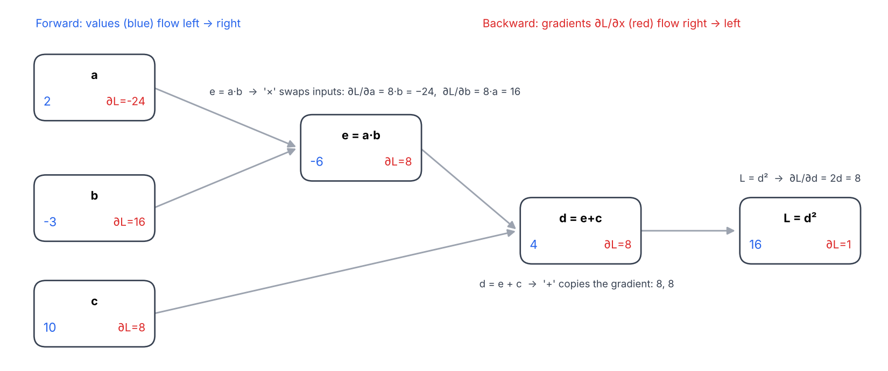
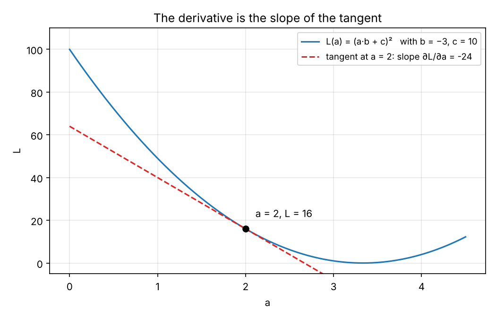
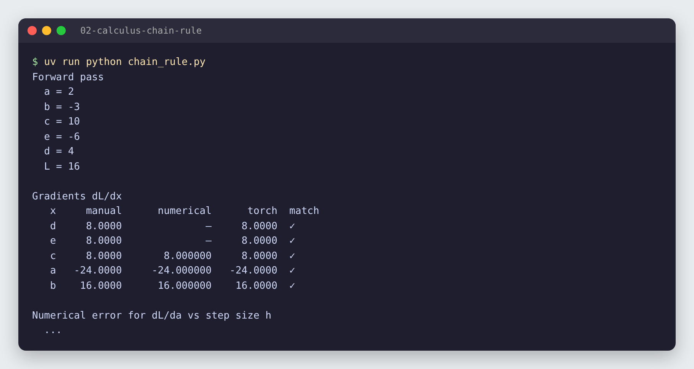
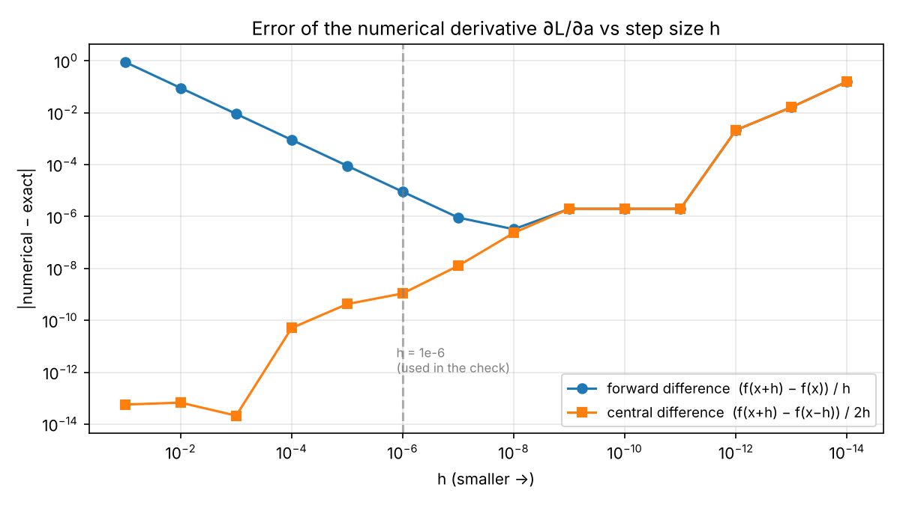

# 02 · Derivatives & the chain rule

🇸🇰 [Slovenská verzia](README.sk.md)

## TL;DR
Backpropagation on a 3-operation computational graph, done three ways: **by hand** with the chain rule, **numerically** with finite differences, and with **PyTorch autograd**. All five gradients agree exactly (e.g. ∂L/∂a = −24, ∂L/∂b = 16). A sweep over the step size `h` shows why numerical gradients are only a sanity check: below h ≈ 1e-8, floating-point rounding makes them *worse*, not better.



## Problem
Project P1 builds an autograd engine from scratch. Autograd is nothing more than the chain rule applied backwards through a graph of simple operations. Before writing that engine, I want to be able to:
1. compute every gradient of a small graph by hand,
2. check it independently (numerically), and
3. confirm it matches what PyTorch computes.

The graph, with `a = 2, b = −3, c = 10`:
```
e = a * b      # -6
d = e + c      #  4
L = d ** 2     # 16
```

## How it works

### 1. What a derivative means
`∂L/∂a` answers: *if I nudge `a` by a tiny amount, how much does `L` change, per unit of nudge?* Geometrically it is the slope of the tangent to `L(a)` at the current point.



At `a = 2` the slope is −24: increasing `a` a little makes `L` drop about 24× as fast. Gradient descent uses exactly this: to lower `L`, move `a` against the sign of the gradient.

### 2. The chain rule, backwards (manual backprop)
If `L` depends on `d`, and `d` depends on `e`, then `∂L/∂e = ∂L/∂d · ∂d/∂e`. So we start at the output with `∂L/∂L = 1` and walk backwards, multiplying by each operation's **local** derivative:

| Step | Operation | Local derivative | Gradient |
|---|---|---|---|
| 1 | `L = d²` | `∂L/∂d = 2d` | `∂L/∂d = 2·4 = 8` |
| 2 | `d = e + c` | `∂d/∂e = 1`, `∂d/∂c = 1` | `∂L/∂e = 8·1 = 8`, `∂L/∂c = 8·1 = 8` |
| 3 | `e = a · b` | `∂e/∂a = b`, `∂e/∂b = a` | `∂L/∂a = 8·(−3) = −24`, `∂L/∂b = 8·2 = 16` |

Two patterns show up in every neural network:
- **Addition routes the gradient unchanged** to all its inputs (`+` is a "gradient distributor").
- **Multiplication swaps the inputs**: the gradient for `a` is scaled by `b`, and vice versa.

In code (`manual_grads` in [`chain_rule.py`](chain_rule.py)):
```python
dL_dd = 2 * d
dL_de = dL_dd * 1.0
dL_dc = dL_dd * 1.0
dL_da = dL_de * b
dL_db = dL_de * a
```

### 3. Numerical check (finite differences)
Independent of any calculus: nudge one input and measure the change.
```python
# central difference: symmetric, more accurate than (f(x+h) - f(x)) / h
(L(a + h) - L(a - h)) / (2 * h)
```
This is how you unit-test an autograd engine: if the analytic gradient and the numerical one disagree, the backward pass has a bug.

### 4. PyTorch autograd
```python
a = torch.tensor(2.0, requires_grad=True)   # likewise b, c
L = ((a * b) + c) ** 2
L.backward()          # fills a.grad, b.grad, c.grad
```
PyTorch records the graph during the forward pass and runs the exact same chain-rule walk backwards. Intermediate tensors (`e`, `d`) only keep `.grad` if you call `.retain_grad()` on them.

## Results


| x | manual | numerical (h = 1e-6) | torch | match |
|---|---:|---:|---:|:---:|
| d | 8 | – | 8 | ✓ |
| e | 8 | – | 8 | ✓ |
| c | 8 | 8.000000 | 8 | ✓ |
| a | −24 | −24.000000 | −24 | ✓ |
| b | 16 | 16.000000 | 16 | ✓ |

### Error analysis: how small should `h` be?


- **Forward difference** error falls linearly with `h` (1e-1 → 0.9, 1e-6 → 9e-6), because it ignores the curvature term of order `h`.
- **Central difference** is far more accurate. For this graph it is exact up to rounding at large `h`, because `L(a)` is a quadratic and the symmetric difference cancels the curvature term completely.
- **Below h ≈ 1e-8 both get worse.** `L(a+h)` and `L(a−h)` become almost identical floats, and subtracting them loses most significant digits (catastrophic cancellation). At h = 1e-14 the error is ~0.16.
- Takeaway: numerical gradients are a slow, approximate test tool (one forward pass per input, per parameter). Backprop gets all gradients exactly in one backward pass, which is why it is used for training.

## 🏎️ On the cars

The same chain rule, only 90 steps long: a braking car must stop exactly on a line. Its stop position depends on the brake force `b` through 90 physics steps, so `dL/db` is a chain of 90 local derivatives. Computed **by hand, numerically and with PyTorch**, exactly like above, all three give −650.934. Gradient descent then finds the right brake (b = 15 → 66.5, stops at 250.4 px for a 250 px target). When the car stops, `max(0, ·)` blocks the gradient, the same thing a ReLU does.


A second part tunes a driver's `aggression` knob by gradient descent on lap time (18.2 s → 13.1 s).

Full chapter: [Racing Lab · ch. 02](../05-racing-lab/README.md#ch-02--chain-rule-and-gradient-descent) · code: [`ch02b_chain_rule.py`](../05-racing-lab/chapters/ch02b_chain_rule.py), [`ch02_gradient.py`](../05-racing-lab/chapters/ch02_gradient.py)

## What I learned
- A derivative is a local slope: how much the output moves per unit of input change.
- The chain rule turns one big derivative into a product of small local ones, computed from output to input.
- `+` copies the gradient, `×` swaps the inputs: enough to backprop through most of a neural network by hand.
- How to verify gradients numerically, and why `h` must be neither too big nor too small.

## Run it
```bash
uv sync
uv run python chain_rule.py   # prints values, gradients, h-sweep; writes results.json
uv run python plot.py         # writes the PNGs in assets/
```

## Limitations
- Scalars only. P1 extends this to a `Value` class that builds the graph automatically, and later to tensors, where the same rules apply element-wise and as matrix products.
