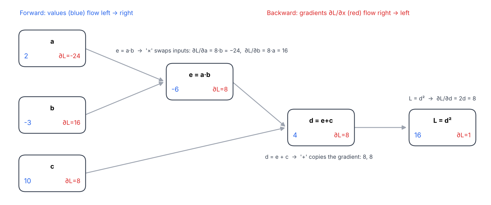
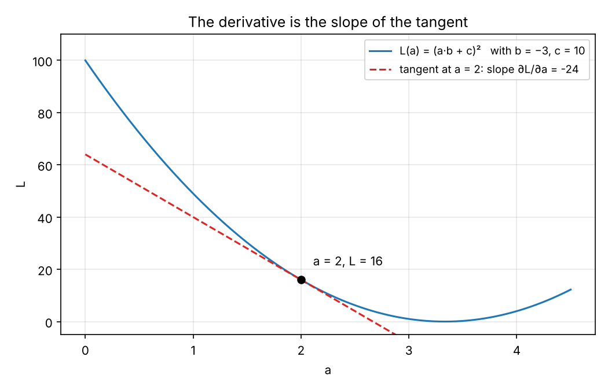
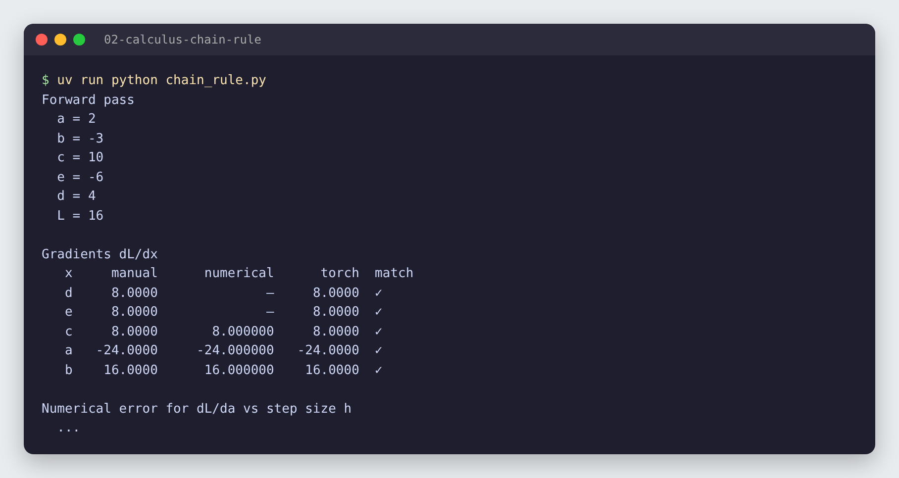
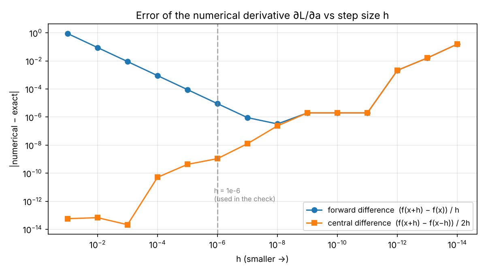

# 02 · Derivácie a chain rule

🇬🇧 [English version](README.md)

## TL;DR
Backpropagation na výpočtovom grafe s tromi operáciami, spravená tromi spôsobmi: **ručne** cez chain rule, **numericky** cez konečné diferencie a cez **PyTorch autograd**. Všetkých päť gradientov sa presne zhoduje (napr. ∂L/∂a = −24, ∂L/∂b = 16). Prechod cez veľkosti kroku `h` ukazuje, prečo sú numerické gradienty len kontrola: pod h ≈ 1e-8 ich zaokrúhľovanie v pohyblivej desatinnej čiarke robí *horšími*, nie lepšími.



## Problém
V projekte P1 sa stavia vlastný autograd engine. Autograd nie je nič iné ako chain rule aplikovaný odzadu na graf jednoduchých operácií. Predtým, než ho napíšem, chcem vedieť:
1. ručne spočítať každý gradient malého grafu,
2. nezávisle ho overiť (numericky) a
3. potvrdiť, že sa zhoduje s tým, čo spočíta PyTorch.

Graf s hodnotami `a = 2, b = −3, c = 10`:
```
e = a * b      # -6
d = e + c      #  4
L = d ** 2     # 16
```

## Ako to funguje

### 1. Čo znamená derivácia
`∂L/∂a` odpovedá na otázku: *ak `a` trochu pohnem, o koľko sa zmení `L` na jednotku posunu?* Geometricky je to sklon dotyčnice ku krivke `L(a)` v danom bode.



Pri `a = 2` je sklon −24: ak `a` trochu zväčšíš, `L` klesá zhruba 24× rýchlejšie. Presne toto využíva gradient descent: aby `L` kleslo, posúvaš `a` proti znamienku gradientu.

### 2. Chain rule odzadu (ručný backprop)
Ak `L` závisí od `d` a `d` od `e`, potom `∂L/∂e = ∂L/∂d · ∂d/∂e`. Začneme preto na výstupe s `∂L/∂L = 1`, ideme dozadu a násobíme **lokálnou** deriváciou každej operácie:

| Krok | Operácia | Lokálna derivácia | Gradient |
|---|---|---|---|
| 1 | `L = d²` | `∂L/∂d = 2d` | `∂L/∂d = 2·4 = 8` |
| 2 | `d = e + c` | `∂d/∂e = 1`, `∂d/∂c = 1` | `∂L/∂e = 8·1 = 8`, `∂L/∂c = 8·1 = 8` |
| 3 | `e = a · b` | `∂e/∂a = b`, `∂e/∂b = a` | `∂L/∂a = 8·(−3) = −24`, `∂L/∂b = 8·2 = 16` |

Dva vzorce, ktoré sa objavia v každej neurónovej sieti:
- **Sčítanie posiela gradient nezmenený** všetkým vstupom (`+` gradient „rozdeľuje“).
- **Násobenie vstupy vymení**: gradient pre `a` sa násobí `b` a naopak.

V kóde (`manual_grads` v [`chain_rule.py`](chain_rule.py)):
```python
dL_dd = 2 * d
dL_de = dL_dd * 1.0
dL_dc = dL_dd * 1.0
dL_da = dL_de * b
dL_db = dL_de * a
```

### 3. Numerická kontrola (konečné diferencie)
Nezávisle od akejkoľvek analýzy: posuň jeden vstup a zmeraj zmenu.
```python
# centrálna diferencia: symetrická, presnejšia ako (f(x+h) - f(x)) / h
(L(a + h) - L(a - h)) / (2 * h)
```
Takto sa testuje autograd engine: ak sa analytický a numerický gradient nezhodujú, backward pass má chybu.

### 4. PyTorch autograd
```python
a = torch.tensor(2.0, requires_grad=True)   # rovnako b, c
L = ((a * b) + c) ** 2
L.backward()          # naplní a.grad, b.grad, c.grad
```
PyTorch si počas forward passu zaznamená graf a potom prejde odzadu presne tým istým chain rule. Medzivýsledky (`e`, `d`) si `.grad` nechajú len vtedy, keď na nich zavoláš `.retain_grad()`.

## Výsledky


| x | ručne | numericky (h = 1e-6) | torch | zhoda |
|---|---:|---:|---:|:---:|
| d | 8 | – | 8 | ✓ |
| e | 8 | – | 8 | ✓ |
| c | 8 | 8,000000 | 8 | ✓ |
| a | −24 | −24,000000 | −24 | ✓ |
| b | 16 | 16,000000 | 16 | ✓ |

### Analýza chýb: aké malé má byť `h`?


- Chyba **doprednej diferencie** klesá lineárne s `h` (1e-1 → 0,9, 1e-6 → 9e-6), lebo ignoruje člen zakrivenia rádu `h`.
- **Centrálna diferencia** je oveľa presnejšia. Pre tento graf je pri veľkom `h` presná až na zaokrúhlenie, pretože `L(a)` je kvadratická funkcia a symetrický rozdiel člen zakrivenia úplne vyruší.
- **Pod h ≈ 1e-8 sa obe zhoršujú.** `L(a+h)` a `L(a−h)` sú takmer rovnaké čísla a ich odčítaním sa stratí väčšina platných číslic (catastrophic cancellation). Pri h = 1e-14 je chyba ~0,16.
- Záver: numerické gradienty sú pomalý a približný testovací nástroj (jeden forward pass na každý vstup a parameter). Backprop dá všetky gradienty presne v jednom spätnom prechode, preto sa používa na tréning.

## 🏎️ Na autíčkach

To isté reťazové pravidlo, len 90 krokov dlhé: brzdiace auto musí zastaviť presne na čiare. Miesto zastavenia závisí od sily brzdy `b` cez 90 krokov fyziky, takže `dL/db` je reťaz 90 lokálnych derivácií. Spočítané **ručne, numericky aj v PyTorchi**, presne ako vyššie, všetky tri dajú −650,934. Gradient descent potom nájde správnu brzdu (b = 15 → 66,5, auto zastaví na 250,4 px pri cieli 250 px). Keď auto zastane, `max(0, ·)` gradient zablokuje, rovnako ako ReLU.


Druhá časť ladí gombík `aggression` vodiča gradient descentom na čase kola (18,2 s → 13,1 s).

Celá kapitola: [Racing Lab · kap. 02](../05-racing-lab/README.sk.md#kap-02--reťazové-pravidlo-a-gradient-descent) · kód: [`ch02b_chain_rule.py`](../05-racing-lab/chapters/ch02b_chain_rule.py), [`ch02_gradient.py`](../05-racing-lab/chapters/ch02_gradient.py)

## Čo som sa naučil
- Derivácia je lokálny sklon: o koľko sa pohne výstup na jednotku zmeny vstupu.
- Chain rule rozloží jednu veľkú deriváciu na súčin malých lokálnych, počítaných od výstupu k vstupu.
- `+` gradient kopíruje, `×` vymení vstupy: to stačí na ručný backprop cez väčšinu neurónovej siete.
- Ako overiť gradienty numericky a prečo `h` nesmie byť ani príliš veľké, ani príliš malé.

## Spustenie
```bash
uv sync
uv run python chain_rule.py   # vypíše hodnoty, gradienty, prechod cez h; zapíše results.json
uv run python plot.py         # zapíše PNG obrázky do assets/
```

## Obmedzenia
- Len skaláry. P1 to rozšíri na triedu `Value`, ktorá si graf postaví sama, a neskôr na tenzory, kde platia tie isté pravidlá po prvkoch a ako maticové súčiny.
