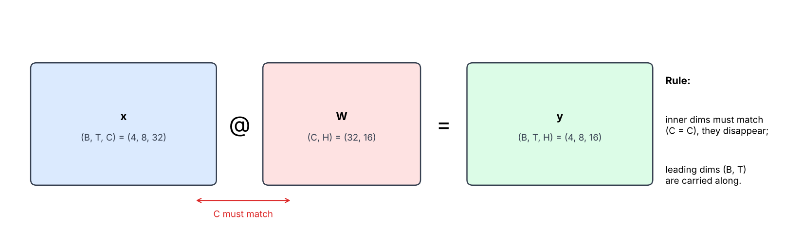
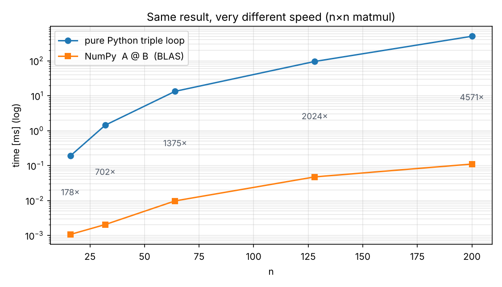
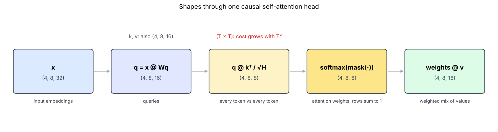
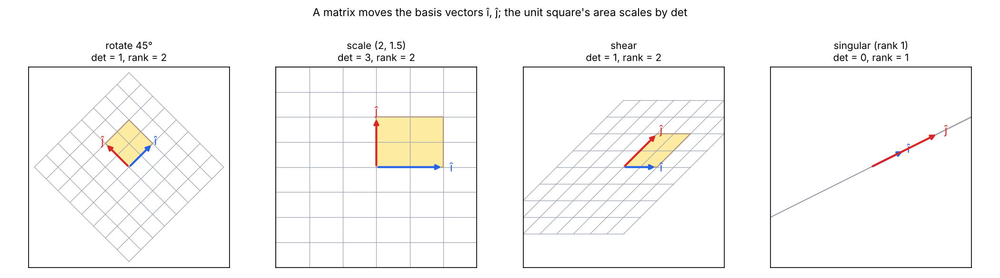
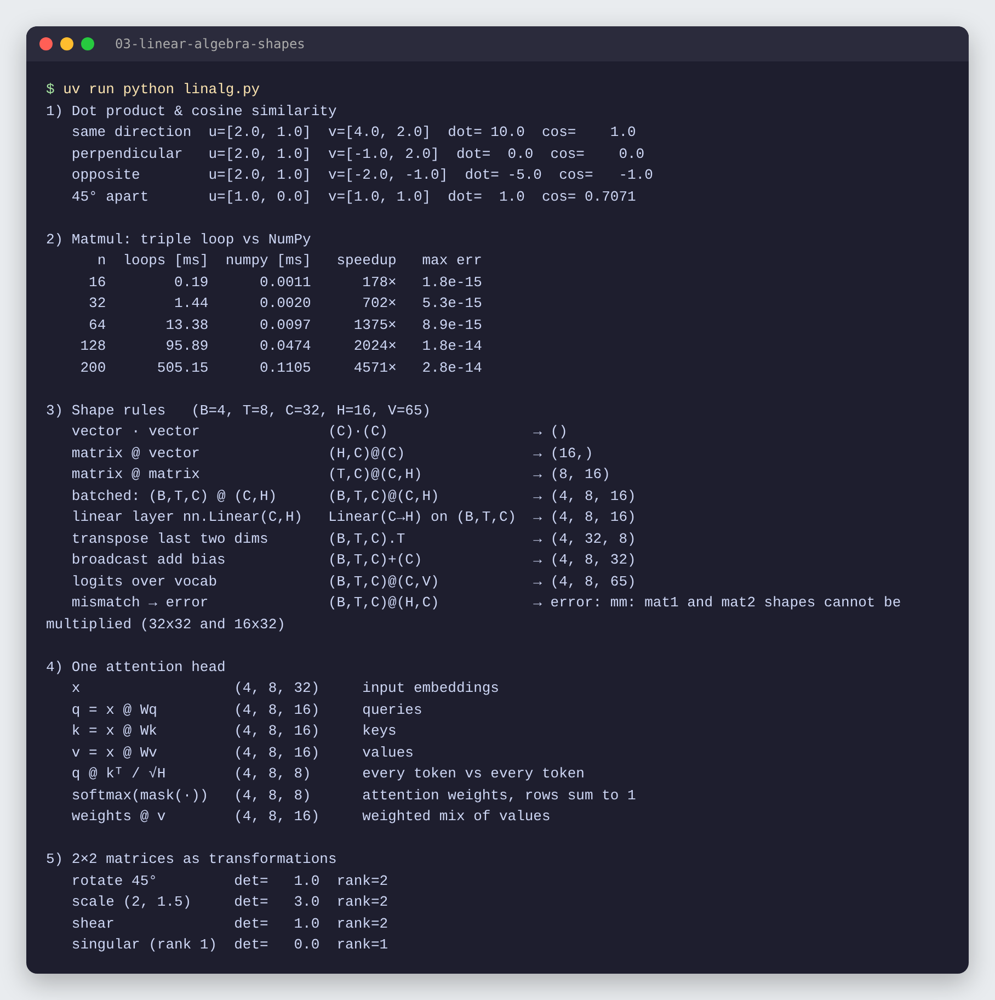

# 03 · Vectors, matrices & shapes

🇸🇰 [Slovenská verzia](README.sk.md)

## TL;DR
The linear algebra a transformer actually uses, checked in code: dot product and cosine similarity, matrix multiplication written from scratch (matches NumPy to ~1e-14, but is up to **4,571× slower**), the shape rules up to **`(B,T,C) @ (C,H) → (B,T,H)`**, the shapes through one attention head, and 2×2 matrices as transformations of the plane.



## Problem
The roadmap's goal for this step: *say the result shape of `(B,T,C) @ (C,H)` without running it.* In P1 and P4 most bugs are shape bugs, and every layer of a neural network (linear layer, attention, output logits) is a matrix multiplication. So I want to:
1. understand what a dot product measures,
2. know exactly what `A @ B` computes and why the shapes must line up,
3. trace tensor shapes through a transformer's attention head.

Dimension names used everywhere: **B** = batch, **T** = time (context length), **C** = channels (embedding size), **H** = head size, **V** = vocab size. Here `B=4, T=8, C=32, H=16, V=65`.

## How it works

### 1. Dot product = "how aligned are two vectors?"
```python
dot(u, v) = sum(u_i * v_i)
cosine(u, v) = dot(u, v) / (|u| * |v|)     # in [-1, 1]
```
| pair | u | v | dot | cosine |
|---|---|---|---:|---:|
| same direction | [2, 1] | [4, 2] | 10 | 1.0 |
| perpendicular | [2, 1] | [−1, 2] | 0 | 0.0 |
| opposite | [2, 1] | [−2, −1] | −5 | −1.0 |
| 45° apart | [1, 0] | [1, 1] | 1 | 0.707 |

The dot product is large when vectors point the same way, zero when perpendicular, negative when opposite. Cosine removes the effect of length. This is exactly how attention scores (`q · k`) and embedding search (P6) decide what is "similar".

### 2. Matrix multiplication from scratch
```python
C[i][j] = sum(A[i][p] * B[p][j] for p in range(k))   # row i of A · column j of B
```
Each output cell is one dot product: a row of `A` with a column of `B`. That is why **A's columns must equal B's rows**: the two vectors in the dot product must have the same length. `(n, k) @ (k, m) → (n, m)`: the inner `k` disappears, the outer dims stay.

The triple loop in `matmul_loops` gives the same result as NumPy (max difference ~1e-14, pure rounding), but:



| n | loops [ms] | NumPy [ms] | speedup |
|---:|---:|---:|---:|
| 16 | 0.19 | 0.0011 | 178× |
| 64 | 13.38 | 0.0097 | 1,375× |
| 200 | 505.15 | 0.1105 | 4,571× |

NumPy calls BLAS: compiled code that uses SIMD instructions, all CPU cores and cache-friendly blocking. The gap grows with `n` because Python's per-operation overhead is paid n³ times. Lesson: never loop over tensor elements in Python; express the computation as matrix operations.

### 3. Shape rules
Checked with real tensors in `shape_rules()`:

| case | expression | result |
|---|---|---|
| vector · vector | (C)·(C) | () a scalar |
| matrix @ vector | (H,C)@(C) | (16,) |
| matrix @ matrix | (T,C)@(C,H) | (8, 16) |
| **batched** | **(B,T,C)@(C,H)** | **(4, 8, 16)** |
| linear layer | `nn.Linear(C,H)` on (B,T,C) | (4, 8, 16) |
| transpose last two | (B,T,C).transpose(-2,-1) | (4, 32, 8) |
| broadcast bias | (B,T,C)+(C) | (4, 8, 32) |
| logits over vocab | (B,T,C)@(C,V) | (4, 8, 65) |
| mismatch | (B,T,C)@(H,C) | error: `shapes cannot be multiplied (32x32 and 16x32)` |

Rules to remember:
- `@` only looks at the **last two** dims; anything before them (B, or B and T) is carried along as a batch.
- The **last dim of the left** must equal the **second-to-last of the right**; it disappears.
- A `(C)` vector **broadcasts** across all leading dims, which is how a bias is added to every token.
- In the error message PyTorch flattened `(4, 8, 32)` into `32x32` rows: B·T = 32 tokens, each with C = 32 features.

### 4. Shapes through one attention head


```python
q, k, v = x @ Wq, x @ Wk, x @ Wv          # (B,T,C)@(C,H) → (B,T,H)
scores  = q @ k.transpose(-2, -1) / H**0.5 # (B,T,H)@(B,H,T) → (B,T,T)
weights = softmax(mask(scores))            # (B,T,T), each row sums to 1
out     = weights @ v                      # (B,T,T)@(B,T,H) → (B,T,H)
```
The `(T, T)` score matrix compares every token with every other one, so attention's memory and compute grow with **T²**. That is the reason for KV cache and the cost of long contexts (P4, P10). The causal mask hides future tokens; the code asserts that every row of `weights` sums to 1.

### 5. A matrix is a transformation


A 2×2 matrix tells you where the basis vectors î = (1,0) and ĵ = (0,1) land (its columns); every other point follows linearly. The **determinant** is how much areas scale: rotation and shear keep area (det = 1), scaling by (2, 1.5) triples it (det = 3), and a singular matrix squashes the plane onto a line (det = 0, rank 1), so information is lost and the matrix can't be inverted. Low-rank matrices come back in P5: LoRA trains a rank-8 update instead of a full matrix.

## Results


- The from-scratch matmul matches NumPy to within 2.8e-14 at every size.
- All shape predictions in the table were confirmed by PyTorch, including the expected error for mismatched inner dimensions.
- Attention weights are `(B, T, T)` and every row sums to 1.

## 🏎️ On the cars

The car's heading is a rotation matrix times `[1, 0]`, the dot product with the track direction says how aligned it is, and every sensor ray hitting a wall is a 2×2 linear system (`det = 0` → parallel). All of it drawn live next to the numbers.


Full chapter: [Racing Lab · ch. 03](../05-racing-lab/README.md#ch-03--vectors-and-matrices) · code: [`chapters/ch03_vectors.py`](../05-racing-lab/chapters/ch03_vectors.py)

## What I learned
- A dot product measures alignment; cosine similarity is the length-free version.
- `A @ B` is a grid of dot products, which is why the inner dims must match and then disappear.
- `@` batches over leading dims, so `(B,T,C) @ (C,H) → (B,T,H)`: a linear layer applied to every token at once.
- Attention builds a `(T, T)` matrix, so its cost is quadratic in context length.
- Determinant = area scale; rank = how many dimensions survive.

## Run it
```bash
uv sync
uv run python linalg.py   # prints all five sections, writes results.json
uv run python plot.py     # writes the PNGs in assets/
```

## Limitations
- Timings are from a 4-thread x86 CPU in the cloud; on an Apple Silicon Mac NumPy (Accelerate) will be faster, the loop numbers similar.
- Eigenvectors and SVD are left for P5 (LoRA), where they are needed.
