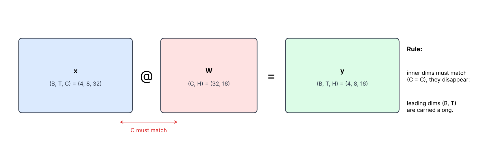
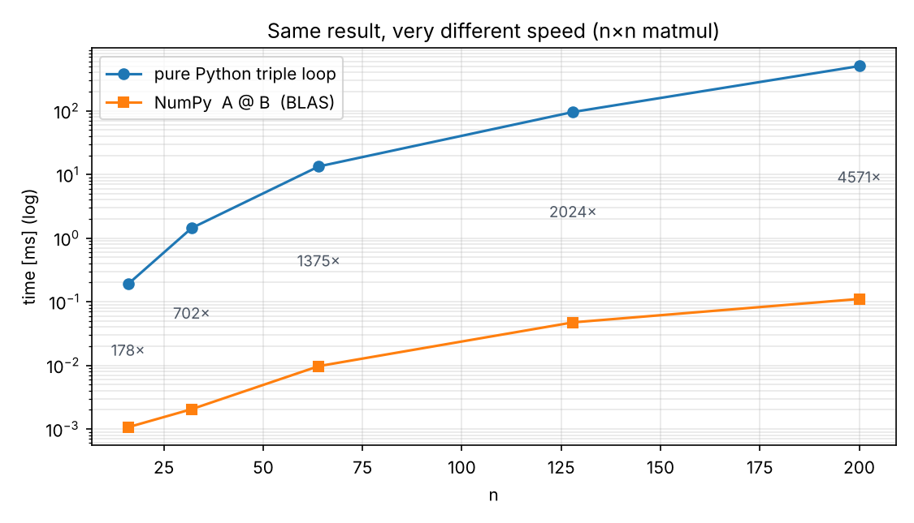
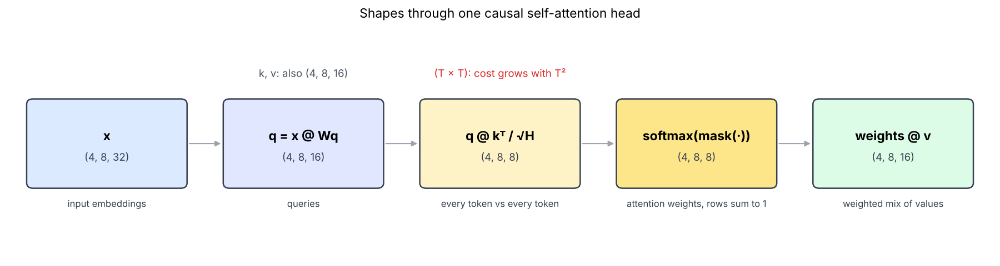
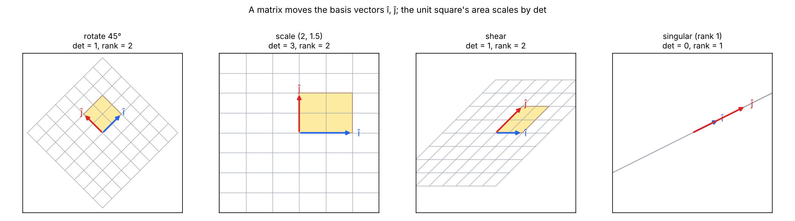
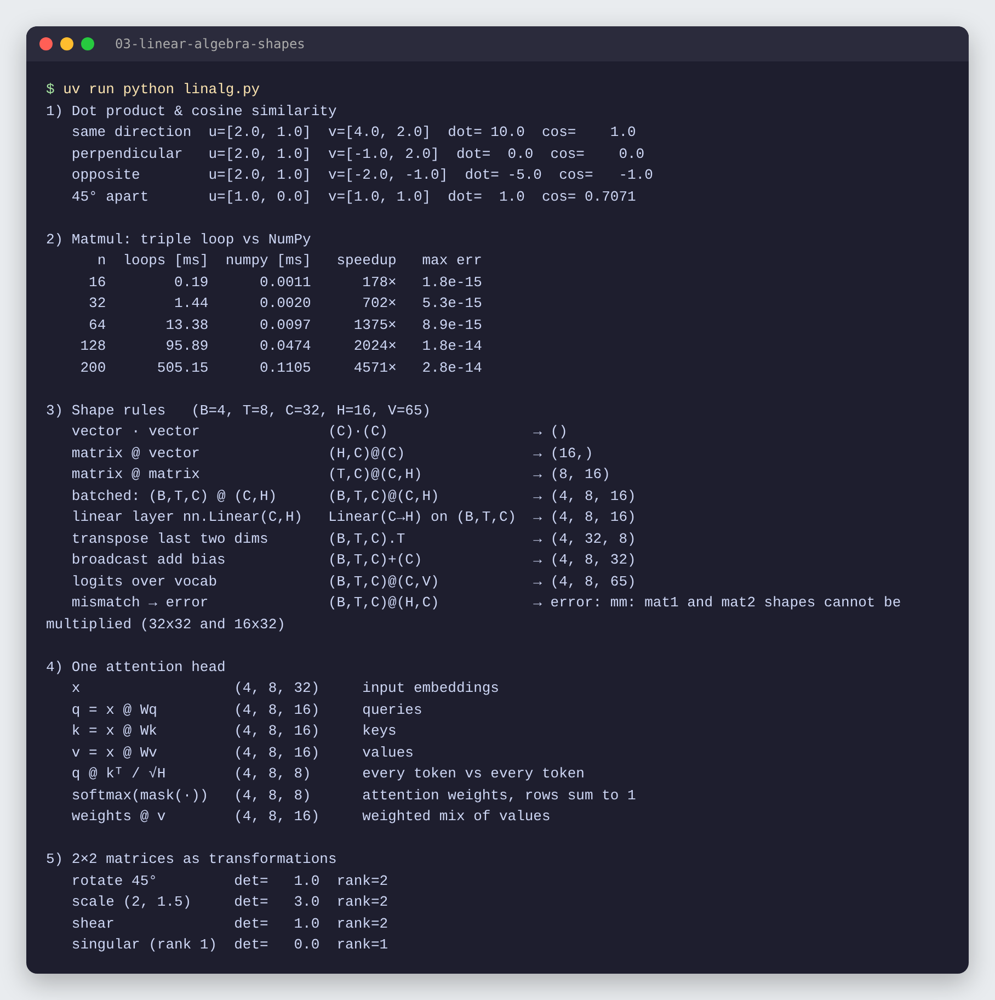

# 03 · Vektory, matice a tvary

🇬🇧 [English version](README.md)

## TL;DR
Lineárna algebra, ktorú transformer naozaj používa, overená v kóde: skalárny súčin a kosínusová podobnosť, násobenie matíc napísané od nuly (zhoduje sa s NumPy na ~1e-14, ale je až **4 571× pomalšie**), pravidlá tvarov až po **`(B,T,C) @ (C,H) → (B,T,H)`**, tvary v jednej attention hlave a matice 2×2 ako transformácie roviny.



## Problém
Cieľ tohto kroku podľa roadmapy: *povedať výsledný tvar `(B,T,C) @ (C,H)` bez spustenia.* V P1 a P4 je väčšina chýb v tvaroch a každá vrstva neurónovej siete (lineárna vrstva, attention, výstupné logity) je násobenie matíc. Chcem preto:
1. rozumieť, čo meria skalárny súčin,
2. presne vedieť, čo počíta `A @ B` a prečo musia tvary sedieť,
3. vysledovať tvary tenzorov cez attention hlavu transformera.

Názvy dimenzií všade rovnaké: **B** = batch, **T** = čas (dĺžka kontextu), **C** = kanály (veľkosť embeddingu), **H** = veľkosť hlavy, **V** = veľkosť slovníka. Tu `B=4, T=8, C=32, H=16, V=65`.

## Ako to funguje

### 1. Skalárny súčin = „ako veľmi sú dva vektory zarovnané?“
```python
dot(u, v) = sum(u_i * v_i)
cosine(u, v) = dot(u, v) / (|u| * |v|)     # v rozsahu [-1, 1]
```
| dvojica | u | v | dot | kosínus |
|---|---|---|---:|---:|
| rovnaký smer | [2, 1] | [4, 2] | 10 | 1,0 |
| kolmé | [2, 1] | [−1, 2] | 0 | 0,0 |
| opačné | [2, 1] | [−2, −1] | −5 | −1,0 |
| 45° od seba | [1, 0] | [1, 1] | 1 | 0,707 |

Skalárny súčin je veľký, keď vektory ukazujú rovnakým smerom, nulový, keď sú kolmé, a záporný, keď sú opačné. Kosínus odstráni vplyv dĺžky. Presne takto attention skóre (`q · k`) aj vyhľadávanie v embeddingoch (P6) rozhodujú, čo je „podobné“.

### 2. Násobenie matíc od nuly
```python
C[i][j] = sum(A[i][p] * B[p][j] for p in range(k))   # riadok i z A · stĺpec j z B
```
Každá výstupná bunka je jeden skalárny súčin: riadok `A` so stĺpcom `B`. Preto **počet stĺpcov A sa musí rovnať počtu riadkov B**: oba vektory v súčine musia mať rovnakú dĺžku. `(n, k) @ (k, m) → (n, m)`: vnútorné `k` zmizne, vonkajšie dimenzie ostanú.

Trojitý cyklus v `matmul_loops` dá rovnaký výsledok ako NumPy (max. rozdiel ~1e-14, čisté zaokrúhlenie), ale:



| n | cykly [ms] | NumPy [ms] | zrýchlenie |
|---:|---:|---:|---:|
| 16 | 0,19 | 0,0011 | 178× |
| 64 | 13,38 | 0,0097 | 1 375× |
| 200 | 505,15 | 0,1105 | 4 571× |

NumPy volá BLAS: skompilovaný kód, ktorý využíva SIMD inštrukcie, všetky jadrá CPU a delenie na bloky šetrné k cache. Rozdiel rastie s `n`, lebo réžiu Pythonu na každú operáciu platíš n³-krát. Ponaučenie: nikdy necykli cez prvky tenzora v Pythone, výpočet vyjadri ako maticové operácie.

### 3. Pravidlá tvarov
Overené na skutočných tenzoroch v `shape_rules()`:

| prípad | výraz | výsledok |
|---|---|---|
| vektor · vektor | (C)·(C) | () skalár |
| matica @ vektor | (H,C)@(C) | (16,) |
| matica @ matica | (T,C)@(C,H) | (8, 16) |
| **dávkové** | **(B,T,C)@(C,H)** | **(4, 8, 16)** |
| lineárna vrstva | `nn.Linear(C,H)` na (B,T,C) | (4, 8, 16) |
| transpozícia posledných dvoch | (B,T,C).transpose(-2,-1) | (4, 32, 8) |
| broadcast biasu | (B,T,C)+(C) | (4, 8, 32) |
| logity cez slovník | (B,T,C)@(C,V) | (4, 8, 65) |
| nesúlad | (B,T,C)@(H,C) | chyba: `shapes cannot be multiplied (32x32 and 16x32)` |

Pravidlá na zapamätanie:
- `@` sa pozerá len na **posledné dve** dimenzie; všetko pred nimi (B, alebo B a T) sa nesie ďalej ako dávka.
- **Posledná dimenzia ľavého** sa musí rovnať **predposlednej pravého**; tá zmizne.
- Vektor `(C)` sa **broadcastuje** cez všetky predchádzajúce dimenzie, takto sa bias pripočíta ku každému tokenu.
- V chybovej hláške PyTorch zlúčil `(4, 8, 32)` do `32x32` riadkov: B·T = 32 tokenov, každý s C = 32 príznakmi.

### 4. Tvary v jednej attention hlave


```python
q, k, v = x @ Wq, x @ Wk, x @ Wv          # (B,T,C)@(C,H) → (B,T,H)
scores  = q @ k.transpose(-2, -1) / H**0.5 # (B,T,H)@(B,H,T) → (B,T,T)
weights = softmax(mask(scores))            # (B,T,T), každý riadok má súčet 1
out     = weights @ v                      # (B,T,T)@(B,T,H) → (B,T,H)
```
Matica skóre `(T, T)` porovnáva každý token s každým, takže pamäť aj výpočet attention rastú s **T²**. To je dôvod pre KV cache a príčina ceny dlhého kontextu (P4, P10). Kauzálna maska skryje budúce tokeny; kód overuje, že každý riadok `weights` má súčet 1.

### 5. Matica je transformácia


Matica 2×2 hovorí, kam sa presunú bázové vektory î = (1,0) a ĵ = (0,1) (sú to jej stĺpce); každý iný bod ich lineárne nasleduje. **Determinant** hovorí, koľkokrát sa zmení plocha: rotácia a skosenie plochu zachovajú (det = 1), škálovanie (2, 1,5) ju strojnásobí (det = 3) a singulárna matica stlačí rovinu na priamku (det = 0, rank 1), takže sa stratí informácia a maticu nejde invertovať. Matice nízkeho ranku sa vrátia v P5: LoRA trénuje update ranku 8 namiesto celej matice.

## Výsledky


- Násobenie matíc od nuly sa zhoduje s NumPy s odchýlkou do 2,8e-14 pri každej veľkosti.
- Všetky predpovede tvarov v tabuľke potvrdil PyTorch, vrátane očakávanej chyby pri nesúlade vnútorných dimenzií.
- Attention váhy majú tvar `(B, T, T)` a každý riadok má súčet 1.

## 🏎️ Na autíčkach

Smer auta je rotačná matica krát `[1, 0]`, skalárny súčin so smerom trate hovorí, nakoľko je auto zarovnané, a každý lúč senzora, ktorý narazí na stenu, je sústava 2×2 (`det = 0` → rovnobežné). Všetko nakreslené naživo vedľa čísel.


Celá kapitola: [Racing Lab · kap. 03](../05-racing-lab/README.sk.md#kap-03--vektory-a-matice) · kód: [`chapters/ch03_vectors.py`](../05-racing-lab/chapters/ch03_vectors.py)

## Čo som sa naučil
- Skalárny súčin meria zarovnanie; kosínusová podobnosť je jeho verzia bez dĺžky.
- `A @ B` je mriežka skalárnych súčinov, preto musia vnútorné dimenzie sedieť a potom zmiznú.
- `@` robí dávku cez predchádzajúce dimenzie, takže `(B,T,C) @ (C,H) → (B,T,H)`: lineárna vrstva naraz na každý token.
- Attention vytvára maticu `(T, T)`, jej cena je kvadratická v dĺžke kontextu.
- Determinant = zmena plochy; rank = koľko dimenzií prežije.

## Spustenie
```bash
uv sync
uv run python linalg.py   # vypíše všetkých päť častí, zapíše results.json
uv run python plot.py     # zapíše PNG obrázky do assets/
```

## Obmedzenia
- Časy sú z 4-vláknového x86 CPU v cloude; na Macu s Apple Silicon bude NumPy (Accelerate) rýchlejší, čísla pre cykly podobné.
- Vlastné vektory a SVD nechávam na P5 (LoRA), kde budú potrebné.
