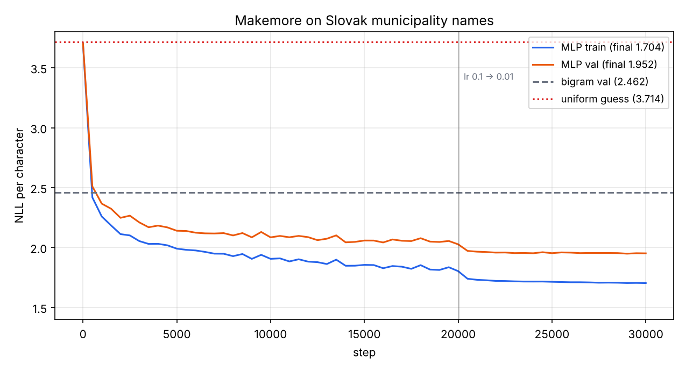
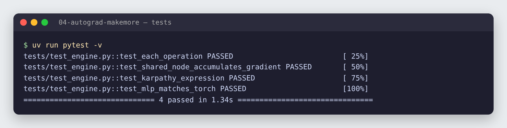
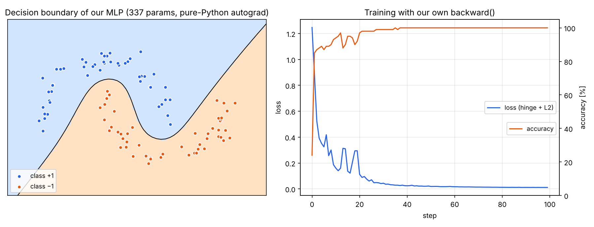
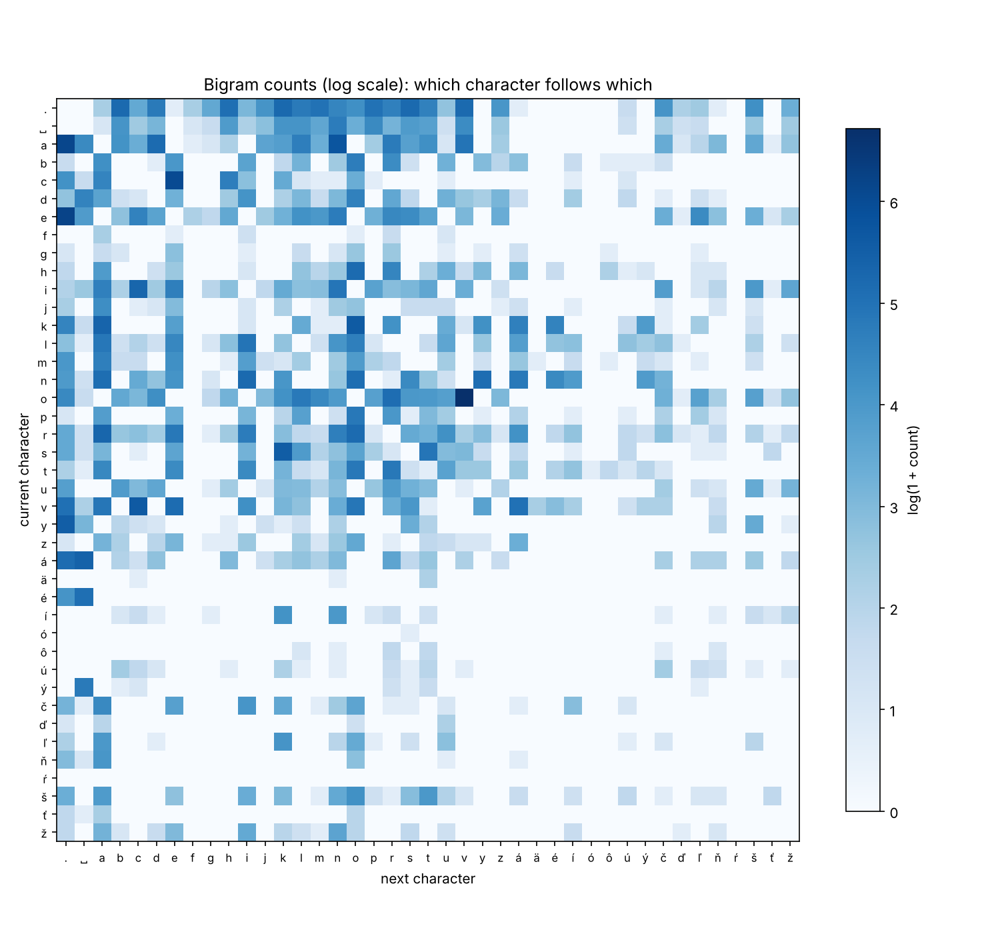
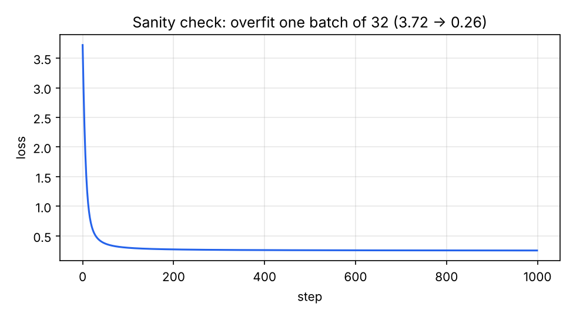
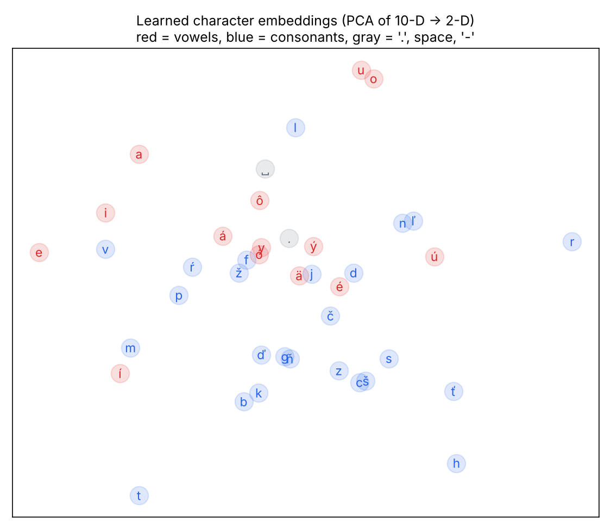
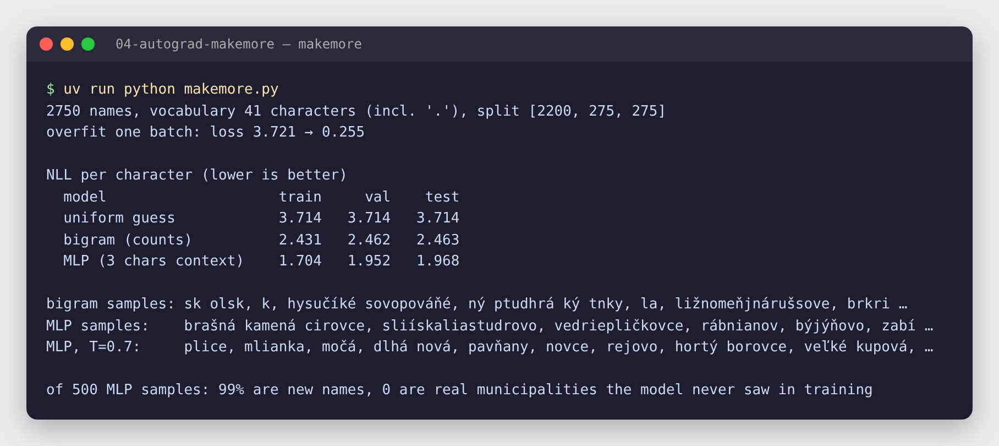

# 04 · P1: Autograd from scratch & makemore

🇸🇰 [Slovenská verzia](README.sk.md)

## TL;DR
A ~150-line scalar **autograd engine** (`Value` + `backward()`) whose gradients match PyTorch exactly (4/4 tests), a small **neural-network library** on top of it that learns a non-linear decision boundary (100 % accuracy), and a **character-level language model** that invents Slovak municipality names.

| model | val NLL / char | test NLL / char |
|---|---:|---:|
| uniform guess | 3.714 | 3.714 |
| bigram (counts) | 2.462 | 2.463 |
| **MLP, 3-char context** | **1.952** | **1.968** |

Samples from the MLP (temperature 0.7): *plavská nad štiarom, veľké kupová, dlhá nová, pavňany, malá ves, klenica, hladice*.



## Problem
Every deep-learning framework is built on the same idea: record how each number was computed, then walk the record backwards with the chain rule. This project builds that idea from zero, then uses it to answer a concrete question: *how much does a neural network beat simple counting at modelling Slovak place names?*

Roadmap goals for P1:
- unit test: my gradients match PyTorch (`torch.allclose`),
- bigram baseline vs MLP, val loss in a table, MLP wins,
- the model generates plausible municipality names.

## Data
`data/obce.txt`: **2,750** Slovak municipality names, lowercased. Source: the MIT-licensed [`slovakia-cities`](https://github.com/danielhusar/slovakia-cities) list (2015, grouped by region). I removed city districts such as "Bratislava - Ružinov" and duplicates. Vocabulary: 40 characters (Slovak diacritics, space, hyphen) + `.` as the start/end token. Split 80/10/10 by name (2,200 / 275 / 275), so validation names were never seen in training.

## How it works

### Part 1: the autograd engine ([`micrograd/engine.py`](micrograd/engine.py))
A `Value` wraps one number and remembers its parents and the operation that made it:
```python
a, b = Value(2.0), Value(-3.0)
L = (a * b + 10) ** 2     # builds a graph: a, b → * → + → **2 → L
L.backward()              # a.grad = -24, b.grad = 16  (same as step 02)
```
Every operation does two things: computes the result, and stores a tiny `_backward` closure with its **local derivative**:
```python
def __mul__(self, other):
    out = Value(self.data * other.data, (self, other), "*")
    def _backward():
        self.grad  += other.data * out.grad   # d(a*b)/da = b
        other.grad += self.data  * out.grad   # d(a*b)/db = a
    out._backward = _backward
    return out
```
`backward()` sorts the graph topologically (every node after the nodes it depends on), sets `L.grad = 1`, and calls each `_backward` from the output to the inputs. That is the chain rule from step 02, automated.

Two details that matter:
- **`+=`, not `=`.** If a value is used twice (`x*x + x`), gradients from both paths must add up. The test `test_shared_node_accumulates_gradient` checks exactly this (`dy/dx = 2x + 1 = 7`).
- **Only a few primitives are needed:** `+`, `*`, `**`, `exp`, `log`, `tanh`, `relu`. Subtraction, division and negation are built from them, so they get correct gradients for free.

### Part 2: tests against PyTorch ([`tests/test_engine.py`](tests/test_engine.py))


- every operation, value and both gradients vs PyTorch,
- a shared node used twice,
- a long expression with 20+ operations,
- a whole 3-layer MLP: every weight's and bias's gradient vs the same network rebuilt in PyTorch.

### Part 3: a neural network on the engine ([`micrograd/nn.py`](micrograd/nn.py), [`train_moons.py`](train_moons.py))
`Neuron` computes `tanh(w·x + b)`, `Layer` is a list of neurons, `MLP` is a list of layers. Training is the loop every framework uses:
```python
loss = hinge_loss(model(X), y) + 1e-4 * sum(p*p for p in params)   # forward
model.zero_grad(); loss.backward()                                   # backward
for p in model.parameters(): p.data -= lr * p.grad                    # update
```


A 337-parameter MLP (2 → 16 → 16 → 1) reaches **100 % accuracy** on 100 points of two interleaving half-moons in 40 steps. A straight line can't separate them; the tanh layers bend the boundary. It is slow (100 steps take ~2 minutes) because every scalar is a Python object: exactly why real frameworks work on tensors (step 03: up to 4,571× faster).

### Part 4: makemore ([`makemore.py`](makemore.py))
The task: given the characters so far, predict the next one. The loss is the **negative log-likelihood** (NLL): `−log P(correct next char)`, averaged over all characters. Lower is better; a model guessing uniformly over 41 characters scores `log(41) = 3.714`.

**Why NLL?** Maximizing the probability of the training data (maximum likelihood) is the same as minimizing `−log` of it, and logs turn a product of many small probabilities into a sum that doesn't underflow. PyTorch's `F.cross_entropy` is exactly this.

**Baseline: bigram.** Count how often each character follows each other one, normalize each row into probabilities (with +1 smoothing so nothing has probability 0).



The darkest cell is `o → v`, from the very common Slovak endings *-ovce*, *-ovo*, *-ov*. But one character of context is too little: bigram samples look like *hysučíké sovopováňé* (val NLL 2.462).

**Model: MLP with a 3-character context** (Bengio et al., 2003):
```python
emb = C[X]                                    # (B, 3)  → (B, 3, 10)   look up 10-D embeddings
h   = tanh(emb.view(-1, 30) @ W1 + b1)        # (B, 30) @ (30, 200)    → (B, 200)
logits = h @ W2 + b2                          # (B, 200) @ (200, 41)   → (B, 41)
loss = F.cross_entropy(logits, Y)
```
Same shape rules as step 03. 14,851 parameters, minibatches of 32, 30,000 steps, learning rate 0.1 → 0.01 after 20,000 steps (the visible drop in the loss curve).

**Initialization matters.** `W2` starts tiny (×0.01), so the first predictions are close to uniform and the initial loss is 3.70, right at `log(41)`. With a careless init the first loss would be much higher and the first thousand steps are wasted undoing it. `W1` uses Kaiming scaling for tanh (`5/3 / √fan_in`) so the hidden layer doesn't saturate.

**Debugging habit: overfit one batch first.** Before real training, the model trains on a single batch of 32 examples. A correct model must be able to memorize it:



Loss 3.72 → 0.26: forward, backward and update are wired correctly. If this fails, there is a bug, and no amount of tuning will fix it.

**The embeddings learn structure on their own.** Nobody told the model which letters are vowels:



Projected to 2-D, *u* and *o* sit together, *a*, *i*, *e* cluster on the left, and most consonants (*b, k, d', g, z, s, c, š, t, h*) gather in the bottom half. The grouping is partial, but it emerged from predicting the next character alone.

## Results


### Hyperparameter sweep ([`sweep.py`](sweep.py))
| hidden | embd | weight decay | steps | batch | params | train | val | gap |
|---:|---:|---:|---:|---:|---:|---:|---:|---:|
| 64 | 8 | 0 | 20k | 32 | 4,593 | 1.812 | 2.071 | 0.259 |
| 100 | 10 | 0 | 20k | 32 | 7,651 | 1.671 | 2.030 | 0.359 |
| 200 | 10 | 0 | 30k | 32 | 14,851 | 1.432 | 2.002 | 0.569 |
| 200 | 10 | 0 | 20k | 128 | 14,851 | 1.479 | 1.984 | 0.505 |
| 100 | 10 | 1e-3 | 20k | 64 | 7,651 | 1.830 | 2.032 | 0.202 |
| **200** | **10** | **1e-3** | **30k** | **32** | **14,851** | **1.704** | **1.952** | **0.248** |

- With only 2,200 training names, a bigger model **overfits**: train loss keeps falling (1.43) while val stalls at 2.00, a gap of 0.57.
- **L2 weight decay** (penalizing large weights) trades train loss for val loss: train 1.43 → 1.70, val 2.00 → 1.95. That became the final model.
- Rule I take away: always choose by **validation** loss, never by training loss.

### Samples
- **Bigram:** *sk olsk, hysučíké sovopováňé, ližnomeňjnárušsove*: right letters, no structure.
- **MLP, T = 1.0:** *brašná kamená cirovce, rábnianov, dolný tirtoň, malý sačovce, ďatince*: Slovak-looking, with typical prefixes (*dolný, malý*) and endings (*-ovce, -any, -ov*).
- **MLP, T = 0.7:** *plavská nad štiarom, veľké kupová, dlhá nová, pavňany, malá ves, klenica, hladice*: lower temperature sharpens the distribution, so samples are more typical and less creative.
- Of 500 samples, **99 % are new names** not in the dataset; the model generalizes instead of copying.

## Error analysis
- **Long names fall apart.** With only 3 characters of context the model can't keep the agreement in multi-word names (*horná ské nad jalovec*). A longer context (or attention, P4) is the fix.
- **Rare letters** (*ŕ, ó, ä*) appear a handful of times; their embeddings and next-character predictions are poorly estimated.
- **Overfitting** dominates at this data size: the train/val gap is still 0.25 after weight decay.

## 🏎️ On the cars

The `micrograd` engine from this step trains an MLP 8 → 8 → 2 that learns to drive by copying a teacher. Copying alone finishes 5/10 unseen tracks; with DAgger (the student drives, the teacher corrects) **7/10**. The GIF shows its neurons lighting up on a track it has never seen.


Full chapter: [Racing Lab · ch. 04](../05-racing-lab/README.md#ch-04--a-neural-network-on-my-micrograd-learns-to-drive) · code: [`chapters/ch04_imitation.py`](../05-racing-lab/chapters/ch04_imitation.py)

## What I learned
- Autograd = a graph of values + a local derivative per operation + a reverse topological walk.
- Gradients accumulate (`+=`) when a value is reused.
- Training loop: forward → `zero_grad` → backward → update, the same in my engine and in PyTorch.
- NLL / cross-entropy is maximum likelihood written as a loss; `log(vocab)` is the "knows nothing" baseline.
- Debug order: check the initial loss, overfit one batch, then train; select by validation loss.

## Run it
```bash
uv sync
uv run pytest -v               # gradients vs PyTorch
uv run python train_moons.py   # ~2 min: MLP on our engine → results_moons.json
uv run python makemore.py      # ~20 s: bigram vs MLP → results_makemore.json
uv run python sweep.py         # ~1 min: hyperparameter table → results_sweep.json
uv run python plot.py          # all figures in assets/
```

## Limitations
- Scalar autograd only; tensors come with PyTorch from here on.
- Small dataset (2,750 names from a 2015 list), so all numbers have noticeable variance between seeds.
- Stretch goal not done yet: makemore part 4 (BatchNorm, activation and gradient histograms).
