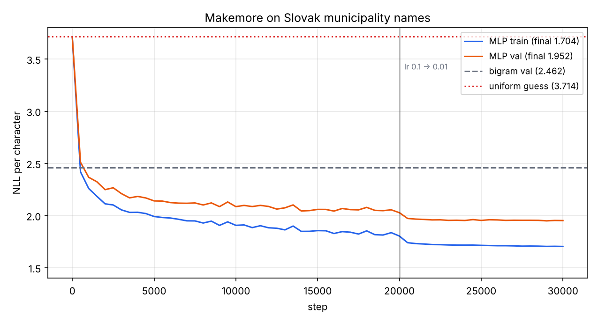
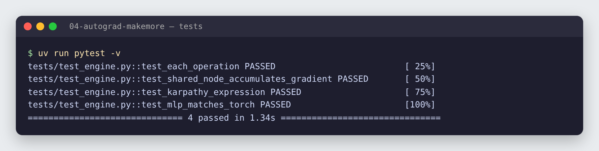
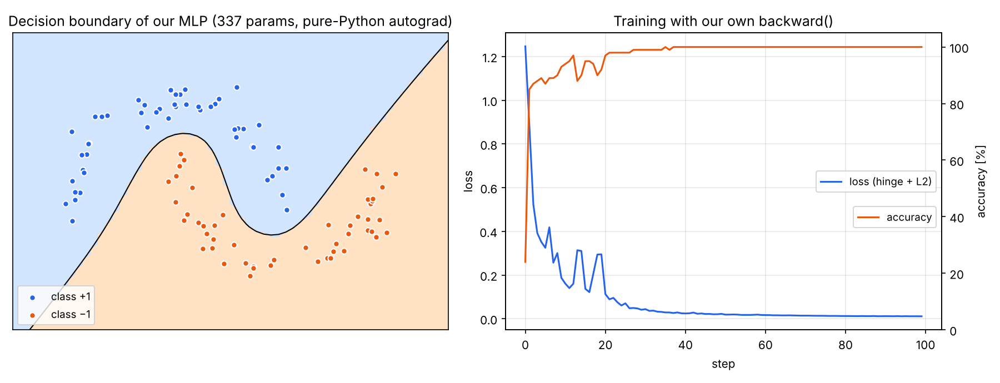
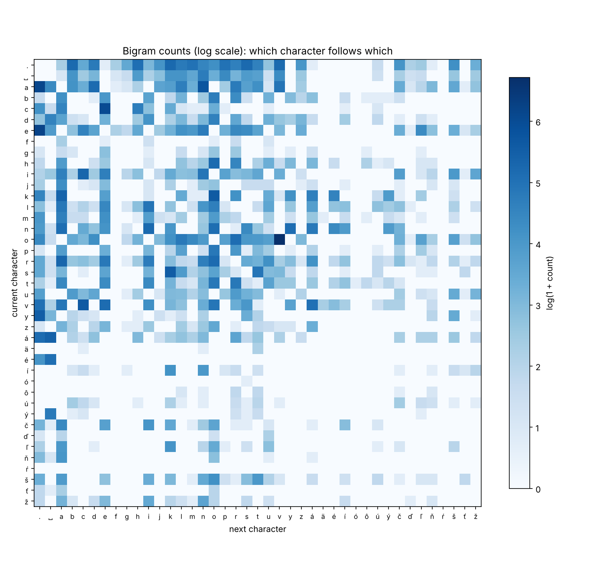
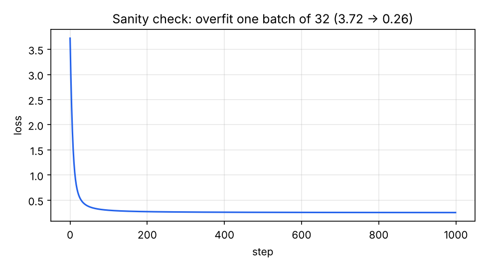
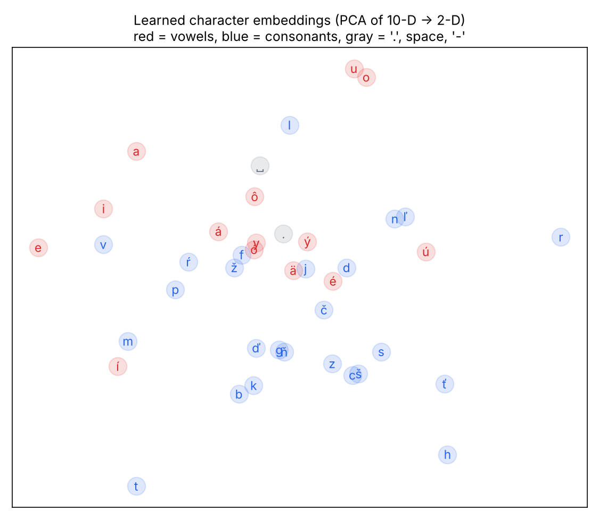
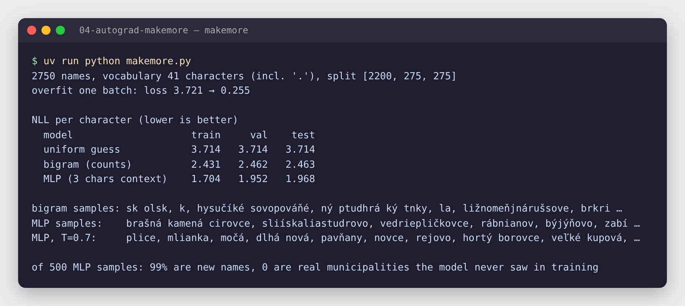

# 04 · P1: Autograd od nuly a makemore

🇬🇧 [English version](README.md)

## TL;DR
Skalárny **autograd engine** na ~150 riadkov (`Value` + `backward()`), ktorého gradienty sa presne zhodujú s PyTorch (4/4 testy), malá **knižnica neurónových sietí** nad ním, ktorá sa naučí nelineárnu hranicu (100 % presnosť), a **znakový jazykový model**, ktorý vymýšľa názvy slovenských obcí.

| model | val NLL / znak | test NLL / znak |
|---|---:|---:|
| rovnomerný tip | 3,714 | 3,714 |
| bigram (počty) | 2,462 | 2,463 |
| **MLP, kontext 3 znaky** | **1,952** | **1,968** |

Ukážky z MLP (teplota 0,7): *plavská nad štiarom, veľké kupová, dlhá nová, pavňany, malá ves, klenica, hladice*.



## Problém
Každý deep-learning framework stojí na rovnakej myšlienke: zaznamenaj, ako vzniklo každé číslo, a potom ten záznam prejdi odzadu s chain rule. Tento projekt postaví túto myšlienku od nuly a potom ju použije na konkrétnu otázku: *o koľko je neurónová sieť lepšia ako obyčajné počítanie pri modelovaní slovenských názvov obcí?*

Ciele P1 z roadmapy:
- unit test: moje gradienty sa zhodujú s PyTorch (`torch.allclose`),
- bigram baseline vs MLP, val loss v tabuľke, MLP vyhrá,
- model generuje vierohodné názvy obcí.

## Dáta
`data/obce.txt`: **2 750** názvov slovenských obcí, malými písmenami. Zdroj: zoznam [`slovakia-cities`](https://github.com/danielhusar/slovakia-cities) pod licenciou MIT (2015, podľa krajov). Odstránil som mestské časti ako „Bratislava - Ružinov“ a duplicity. Slovník: 40 znakov (slovenská diakritika, medzera, pomlčka) + `.` ako značka začiatku a konca. Rozdelenie 80/10/10 podľa názvov (2 200 / 275 / 275), takže validačné názvy model pri tréningu nevidel.

## Ako to funguje

### Časť 1: autograd engine ([`micrograd/engine.py`](micrograd/engine.py))
`Value` obalí jedno číslo a pamätá si svojich rodičov a operáciu, ktorá ho vytvorila:
```python
a, b = Value(2.0), Value(-3.0)
L = (a * b + 10) ** 2     # postaví graf: a, b → * → + → **2 → L
L.backward()              # a.grad = -24, b.grad = 16  (rovnako ako v kroku 02)
```
Každá operácia robí dve veci: spočíta výsledok a uloží malú funkciu `_backward` so svojou **lokálnou deriváciou**:
```python
def __mul__(self, other):
    out = Value(self.data * other.data, (self, other), "*")
    def _backward():
        self.grad  += other.data * out.grad   # d(a*b)/da = b
        other.grad += self.data  * out.grad   # d(a*b)/db = a
    out._backward = _backward
    return out
```
`backward()` zoradí graf topologicky (každý uzol až po uzloch, od ktorých závisí), nastaví `L.grad = 1` a zavolá každé `_backward` od výstupu k vstupom. To je chain rule z kroku 02, len zautomatizovaný.

Dva dôležité detaily:
- **`+=`, nie `=`.** Ak sa hodnota použije dvakrát (`x*x + x`), gradienty z oboch ciest sa musia sčítať. Presne toto overuje test `test_shared_node_accumulates_gradient` (`dy/dx = 2x + 1 = 7`).
- **Stačí pár primitív:** `+`, `*`, `**`, `exp`, `log`, `tanh`, `relu`. Odčítanie, delenie a negácia sú poskladané z nich, takže majú správne gradienty zadarmo.

### Časť 2: testy proti PyTorch ([`tests/test_engine.py`](tests/test_engine.py))


- každá operácia: hodnota aj oba gradienty vs PyTorch,
- zdieľaný uzol použitý dvakrát,
- dlhý výraz s 20+ operáciami,
- celé 3-vrstvové MLP: gradient každej váhy a biasu vs tá istá sieť postavená v PyTorch.

### Časť 3: neurónová sieť nad enginom ([`micrograd/nn.py`](micrograd/nn.py), [`train_moons.py`](train_moons.py))
`Neuron` počíta `tanh(w·x + b)`, `Layer` je zoznam neurónov, `MLP` je zoznam vrstiev. Tréning je slučka, ktorú používa každý framework:
```python
loss = hinge_loss(model(X), y) + 1e-4 * sum(p*p for p in params)   # forward
model.zero_grad(); loss.backward()                                   # backward
for p in model.parameters(): p.data -= lr * p.grad                    # update
```


MLP s 337 parametrami (2 → 16 → 16 → 1) dosiahne **100 % presnosť** na 100 bodoch dvoch prepletených polmesiacov za 40 krokov. Priamka ich neoddelí, tanh vrstvy hranicu ohnú. Je to pomalé (100 krokov trvá ~2 minúty), lebo každý skalár je Python objekt: presne preto skutočné frameworky pracujú s tenzormi (krok 03: až 4 571× rýchlejšie).

### Časť 4: makemore ([`makemore.py`](makemore.py))
Úloha: z doterajších znakov predpovedať ďalší. Loss je **negatívna log-vierohodnosť** (NLL): `−log P(správny ďalší znak)`, spriemerovaná cez všetky znaky. Nižšie je lepšie; model, ktorý háda rovnomerne medzi 41 znakmi, má `log(41) = 3,714`.

**Prečo NLL?** Maximalizovať pravdepodobnosť trénovacích dát (maximum likelihood) je to isté ako minimalizovať jej `−log`, a logaritmus zmení súčin mnohých malých pravdepodobností na súčet, ktorý nepodtečie. `F.cross_entropy` v PyTorch je presne toto.

**Baseline: bigram.** Spočítaj, ako často ktorý znak nasleduje po ktorom, a každý riadok normalizuj na pravdepodobnosti (s vyhladením +1, aby nič nemalo pravdepodobnosť 0).



Najtmavšia bunka je `o → v` z veľmi častých slovenských koncoviek *-ovce*, *-ovo*, *-ov*. Jeden znak kontextu je však málo: bigram generuje veci ako *hysučíké sovopováňé* (val NLL 2,462).

**Model: MLP s kontextom 3 znakov** (Bengio a kol., 2003):
```python
emb = C[X]                                    # (B, 3)  → (B, 3, 10)   10-D embeddingy
h   = tanh(emb.view(-1, 30) @ W1 + b1)        # (B, 30) @ (30, 200)    → (B, 200)
logits = h @ W2 + b2                          # (B, 200) @ (200, 41)   → (B, 41)
loss = F.cross_entropy(logits, Y)
```
Tie isté pravidlá tvarov ako v kroku 03. 14 851 parametrov, minibatche po 32, 30 000 krokov, learning rate 0,1 → 0,01 po 20 000 krokoch (viditeľný skok v krivke lossu).

**Na inicializácii záleží.** `W2` začína veľmi malé (×0,01), takže prvé predpovede sú takmer rovnomerné a počiatočný loss je 3,70, presne pri `log(41)`. Pri nedbalej inicializácii by bol prvý loss oveľa vyšší a prvých tisíc krokov by sa minulo na jeho napravovanie. `W1` používa Kaiming škálovanie pre tanh (`5/3 / √fan_in`), aby sa skrytá vrstva nesaturovala.

**Debugovací návyk: najprv preučiť jeden batch.** Pred skutočným tréningom sa model trénuje na jedinom batchi 32 príkladov. Správny model si ho musí vedieť zapamätať:



Loss 3,72 → 0,26: forward, backward aj update sú zapojené správne. Ak toto zlyhá, je tam chyba a žiadne ladenie hyperparametrov to neopraví.

**Embeddingy sa samy naučia štruktúru.** Nikto modelu nepovedal, ktoré písmená sú samohlásky:



V 2-D projekcii sú *u* a *o* spolu, *a*, *i*, *e* sa zhlukujú vľavo a väčšina spoluhlások (*b, k, ď, g, z, s, c, š, t, h*) je v dolnej polovici. Zoskupenie je čiastočné, ale vzniklo len z predpovedania ďalšieho znaku.

## Výsledky


### Prehľadávanie hyperparametrov ([`sweep.py`](sweep.py))
| hidden | embd | weight decay | kroky | batch | parametre | train | val | rozdiel |
|---:|---:|---:|---:|---:|---:|---:|---:|---:|
| 64 | 8 | 0 | 20k | 32 | 4 593 | 1,812 | 2,071 | 0,259 |
| 100 | 10 | 0 | 20k | 32 | 7 651 | 1,671 | 2,030 | 0,359 |
| 200 | 10 | 0 | 30k | 32 | 14 851 | 1,432 | 2,002 | 0,569 |
| 200 | 10 | 0 | 20k | 128 | 14 851 | 1,479 | 1,984 | 0,505 |
| 100 | 10 | 1e-3 | 20k | 64 | 7 651 | 1,830 | 2,032 | 0,202 |
| **200** | **10** | **1e-3** | **30k** | **32** | **14 851** | **1,704** | **1,952** | **0,248** |

- S iba 2 200 trénovacími názvami väčší model **preučí**: train loss ďalej klesá (1,43), kým val stojí na 2,00, rozdiel 0,57.
- **L2 weight decay** (trest za veľké váhy) vymení train loss za val loss: train 1,43 → 1,70, val 2,00 → 1,95. To je finálny model.
- Pravidlo, ktoré si beriem: vyberaj vždy podľa **validačného** lossu, nikdy podľa trénovacieho.

### Ukážky
- **Bigram:** *sk olsk, hysučíké sovopováňé, ližnomeňjnárušsove*: správne písmená, žiadna štruktúra.
- **MLP, T = 1,0:** *brašná kamená cirovce, rábnianov, dolný tirtoň, malý sačovce, ďatince*: vyzerá po slovensky, s typickými predponami (*dolný, malý*) a koncovkami (*-ovce, -any, -ov*).
- **MLP, T = 0,7:** *plavská nad štiarom, veľké kupová, dlhá nová, pavňany, malá ves, klenica, hladice*: nižšia teplota zaostrí rozdelenie, takže ukážky sú typickejšie a menej kreatívne.
- Z 500 ukážok je **99 % nových názvov**, ktoré v datasete nie sú; model zovšeobecňuje, nekopíruje.

## Analýza chýb
- **Dlhé názvy sa rozpadajú.** S kontextom 3 znaky model neudrží zhodu vo viacslovných názvoch (*horná ské nad jalovec*). Riešením je dlhší kontext alebo attention (P4).
- **Zriedkavé písmená** (*ŕ, ó, ä*) sa vyskytujú len párkrát; ich embeddingy a predpovede sú zle odhadnuté.
- Pri tejto veľkosti dát dominuje **preučenie**: rozdiel train/val je aj po weight decay 0,25.

## 🏎️ Na autíčkach

Engine `micrograd` z tohto kroku trénuje MLP 8 → 8 → 2, ktorá sa učí jazdiť napodobňovaním učiteľa. Samotné napodobňovanie dokončí 5/10 nevidených tratí; s DAggerom (jazdí študent, učiteľ opravuje) **7/10**. GIF ukazuje, ako jej neuróny svietia na trati, ktorú nikdy nevidela.


Celá kapitola: [Racing Lab · kap. 04](../05-racing-lab/README.sk.md#kap-04--neurónová-sieť-na-mojom-micrograde-sa-učí-jazdiť) · kód: [`chapters/ch04_imitation.py`](../05-racing-lab/chapters/ch04_imitation.py)

## Čo som sa naučil
- Autograd = graf hodnôt + lokálna derivácia pri každej operácii + spätný topologický prechod.
- Gradienty sa pri opakovanom použití hodnoty sčítavajú (`+=`).
- Tréningová slučka: forward → `zero_grad` → backward → update, rovnaká v mojom engine aj v PyTorch.
- NLL / cross-entropy je maximum likelihood zapísaný ako loss; `log(veľkosť slovníka)` je baseline „neviem nič“.
- Poradie debugovania: skontroluj počiatočný loss, preuč jeden batch, potom trénuj; vyberaj podľa validačného lossu.

## Spustenie
```bash
uv sync
uv run pytest -v               # gradienty vs PyTorch
uv run python train_moons.py   # ~2 min: MLP na našom engine → results_moons.json
uv run python makemore.py      # ~20 s: bigram vs MLP → results_makemore.json
uv run python sweep.py         # ~1 min: tabuľka hyperparametrov → results_sweep.json
uv run python plot.py          # všetky grafy do assets/
```

## Obmedzenia
- Len skalárny autograd; odteraz tenzory cez PyTorch.
- Malý dataset (2 750 názvov zo zoznamu z roku 2015), takže všetky čísla sa medzi seedmi citeľne líšia.
- Stretch cieľ zatiaľ nesplnený: makemore časť 4 (BatchNorm, histogramy aktivácií a gradientov).
