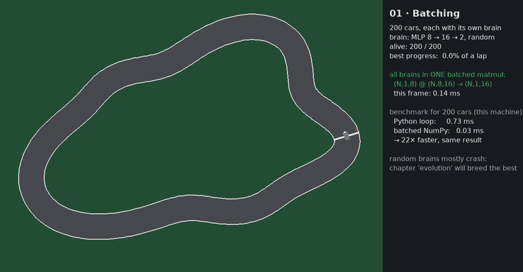
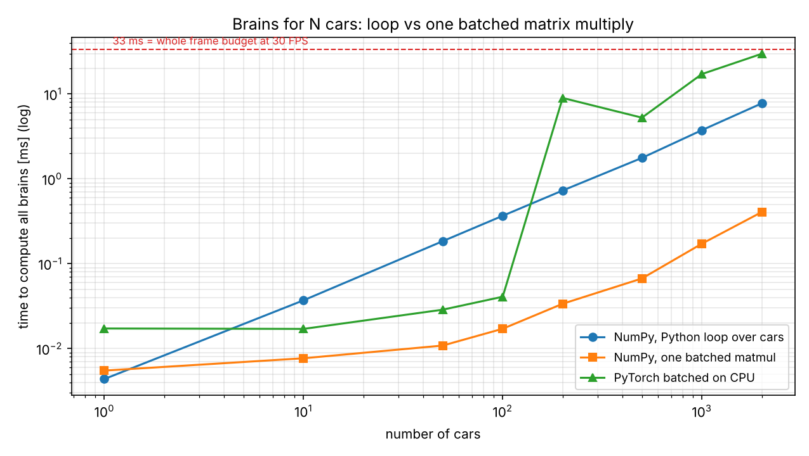
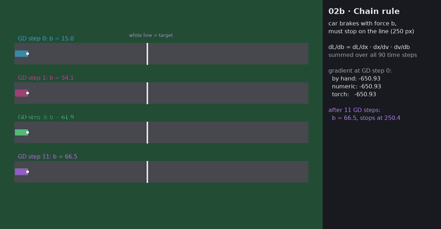
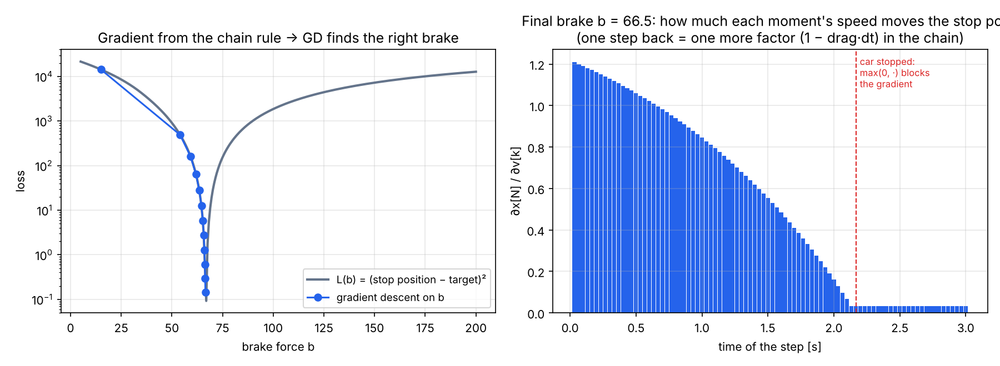
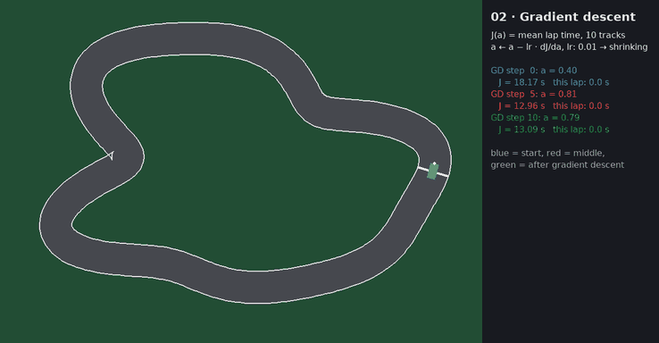
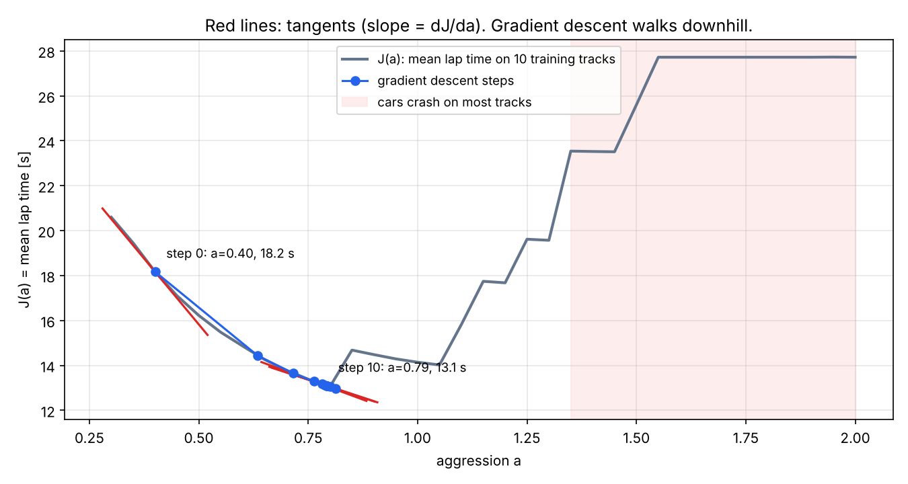
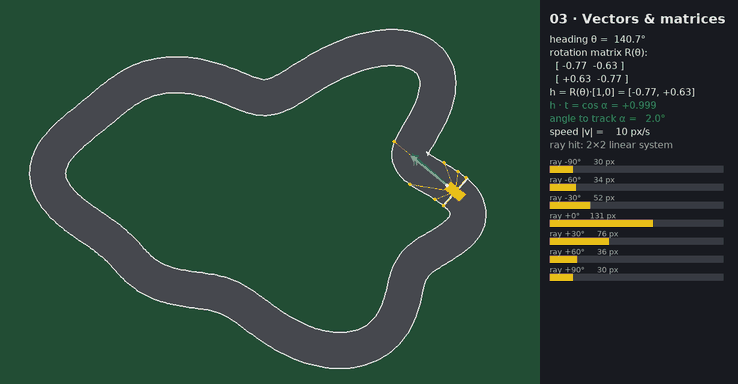
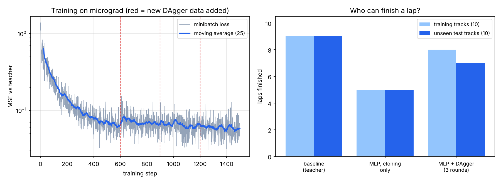

# 05 · Racing Lab: ML concepts, explained on cars

🇸🇰 [Slovenská verzia](README.sk.md)

A small 2-D racing simulator in Python where cars learn to drive a track as fast as possible. This is not a one-off project. It is a **visual lab that grows with the roadmap**: a step gets a chapter here **when its concept maps naturally to the cars**. Steps where cars would be forced (LLM fine-tuning, RAG, agents) get a different visual example inside the step itself. You can watch each one live with `--watch`.


## Chapters

| Ch. | Step | What you see on the cars | Concept | Status |
|---|---|---|---|---|
| [01 · Batching](#ch-01--batching-200-brains-in-one-matmul) | [01](../01-setup-benchmark/) | 200 cars with random brains, all computed in one matmul | batched tensors, CPU vs GPU, timing | ✅ |
| [02 · Chain rule & gradient descent](#ch-02--chain-rule-and-gradient-descent) | [02](../02-calculus-chain-rule/) | a braking car learns to stop on a line (backprop through 90 time steps); 3 cars from GD steps race | chain rule, derivative, gradient descent | ✅ |
| [03 · Vectors & matrices](#ch-03--vectors-and-matrices) | [03](../03-linear-algebra-shapes/) | heading and track vectors, dot product, rotation matrix, rays | vectors, R(θ), linear systems | ✅ |
| [04 · Imitation learning](#ch-04--a-neural-network-on-my-micrograd-learns-to-drive) | [04](../04-autograd-makemore/) | an MLP on my own autograd engine drives unseen tracks, neurons light up | MLP, MSE, backprop, train/test, DAgger | ✅ |
| next | steps where it fits | one chapter per fitting step | see [plan below](#next-chapters) | 🚧 |

## The simulator (shared by all chapters)

| Part | File | How it works |
|---|---|---|
| Tracks | `racing/track.py` | Closed loop: radius = sum of sine waves (harmonics 2–6) with random amplitude. 10 training tracks (seeds 0–9) and 10 **unseen test tracks** (seeds 100–109). |
| Car | `racing/car.py` | Arcade physics: position, heading, speed. Inputs: `steer ∈ [−1, 1]`, `throttle ∈ [−1, 1]`. All N cars are updated with NumPy arrays at once. |
| Sensors | `racing/car.py` | 7 rays at −90°…+90°. Ray vs wall segment is a 2×2 linear system solved with Cramer's rule. Observation = 7 distances / 220 + speed / max → **8 numbers**. |
| Baseline driver | `racing/drivers.py` | Hand-written: steer toward the side with more space, target speed proportional to free space ahead. Knob `aggression`. |
| Rendering | `racing/render.py` | pygame: the same code draws a live window (`--watch`) or GIF frames (headless). |

The car sees only 8 numbers and outputs 2. Small enough to understand every weight.

## Ch. 01 · Batching: 200 brains in one matmul

**Step 01 taught:** the GPU is fast only with large batches; measure, and synchronise before stopping the timer.

**On the cars:** each of 200 cars has its own MLP brain 8 → 16 → 2. You can compute it with a Python loop over cars, or as one batched matrix multiply `(N,1,8) @ (N,8,16)`. Same answer (checked with `allclose`), very different time.




| Cars | Python loop | Batched NumPy | Speed-up |
|---|---|---|---|
| 10 | 0.037 ms | 0.008 ms | 5× |
| 200 | 0.73 ms | 0.034 ms | **21×** |
| 2000 | 7.8 ms | 0.41 ms | 19× |

At 2000 cars the loop would eat a quarter of the 33 ms frame budget. The random brains mostly crash; that is expected: nobody trained them yet. *(Cloud machine, CPU only. On the Mac the script also measures PyTorch on MPS.)*

## Ch. 02 · Chain rule and gradient descent

**Step 02 taught:** the chain rule (backprop on `e = a·b, d = e + c, L = d²`), checked three ways: by hand, numerically, with PyTorch; a derivative is a slope and gradient descent walks downhill.

### Part A · The chain rule on a braking car (`ch02b_chain_rule.py`)

A car arrives at 300 px/s and brakes with a constant force `b`. It must stop exactly on a white line at 250 px. One physics step is

```
v[k+1] = max(0, v[k] − b·dt − drag·v[k]·dt)
x[k+1] = x[k] + v[k+1]·dt
```

and the loss is `L(b) = (x[N] − 250)²`. The stop position depends on `b` through **90 nested steps**, so `dL/db` is a long chain: `dL/dx[N] · Σ dx[N]/dv[k] · dv[k]/db`. It is exactly step 02's graph, only longer. The script computes it the same three ways:

| Gradient at b = 15 | Value |
|---|---|
| by hand (backward loop over time, `manual_grad`) | −650.934 |
| numerical, central difference | −650.934 |
| PyTorch autograd | −650.934 |

All three agree at every GD step. Gradient descent then moves `b` from 15 to **66.5** in 11 steps; the car stops at 250.4 px.




The right plot is the chain rule made visible: going one step further back in time adds one more factor `(1 − drag·dt)`, so early speed matters more for the stop point. After the car stops, `max(0, ·)` has derivative 0 and blocks the gradient: same as a ReLU in a network.

### Part B · Gradient descent on a driver's knob (`ch02_gradient.py`)

**On the cars:** the baseline driver has one parameter `a` = aggression. The loss is `J(a)` = mean lap time on 10 training tracks (a crash counts as 30 s). Too timid → slow. Too brave → crashes. We estimate `dJ/da` numerically and update `a ← a − lr · dJ/da`.




| | a | J(a) |
|---|---|---|
| start (GD step 0) | 0.40 | 18.17 s |
| after 10 GD steps | **0.79** | **13.09 s** |

The lesson: with a fixed learning rate GD jumped back and forth across the "crash cliff" near a ≈ 0.85, where the loss is not smooth. A shrinking learning rate (`0.01 · 0.75^k`) fixed it.

## Ch. 03 · Vectors and matrices

**Step 03 taught:** shapes, matrix products, rotation, dot product.

**On the cars:**
- blue arrow `h = R(θ) · [1, 0]`: the car's heading is a rotation matrix applied to "forward";
- green arrow `t`: the direction of the track;
- `h · t = cos α`: 1 means aligned, 0 means driving across the track;
- yellow rays: each is `R(θ + offset) · [1, 0]`, cut where it hits a wall. That hit is a 2×2 linear system; `det = 0` means the ray is parallel to the wall.



## Ch. 04 · A neural network on my micrograd learns to drive

**Step 04 taught:** an autograd engine (`Value`, `backward()`), an MLP, a loss, gradient descent, train/val split.

**On the cars:** a student network MLP 8 → 8 → 2 built from **my own `micrograd` from step 04** (no PyTorch) learns to copy a teacher.
1. **Behaviour cloning:** the teacher (baseline driver) drives the 10 training tracks; every 3rd frame becomes an example `(8 sensors → steer, throttle)`. 600 steps of MSE + `backward()` + SGD.
2. **DAgger:** now the *student* drives, the teacher labels what it would have done in those states, those examples are added, retrain (3 rounds).
3. **Test:** both drive the 10 test tracks they have never seen.



| Driver | Training tracks finished | Unseen test tracks finished | Mean test lap |
|---|---|---|---|
| Baseline (teacher) | 9/10 | 9/10 | 11.74 s |
| MLP, cloning only | 5/10 | 5/10 | 11.33 s |
| MLP + DAgger (3 rounds) | **8/10** | **7/10** | 11.54 s |

Why cloning alone fails: the teacher never makes mistakes, so the data has no examples of "I am too close to the wall, what now?". The student makes a small error, ends up somewhere the teacher never was, and the errors snowball. DAgger collects exactly those states (1069 → 3957 examples). The loss on the left plot jumps a little at each red line because the new examples are harder ones.

Want to be the teacher yourself? `uv run python -m chapters.play` records your laps (arrow keys), then `uv run python -m chapters.ch04_imitation --demos data/my_laps.npz`.

## Next chapters

Chapters are added only where the cars genuinely help. Current plan:

| Step (phase) | Chapter idea |
|---|---|
| P2 · classic ML, evaluation | **Does it generalize?** All drivers × train/val/test tracks in one table; overfitting on 1 track vs 10 tracks; choosing by validation. Plus **evolution**: optimisation without gradients, compared with GD. |
| P3 · deep learning, CNN | **Driving from pixels:** a small top-down camera image instead of rays, a CNN in PyTorch on MPS, Grad-CAM shows where it looks. |
| after P3 · RL | **Reinforcement learning:** PPO learns only from reward (progress − crashes). Copying vs evolution vs RL on the same test tracks. |
| P10 · inference | export the policy to ONNX / Core ML, 1000 cars at once, FPS before/after, quantisation. |
| P11 · MLOps | every training run logged to MLflow; a CI check fails if a new model is slower on the test tracks. |

Steps **without** a car chapter, because the cars would be forced. They get their own visual example inside the step:

| Step | Better example than cars |
|---|---|
| P4 · transformers | attention heatmaps on real sentences, a tiny GPT generating text token by token |
| P5–P6 · fine-tuning, retrieval | before/after answers of the fine-tuned model, embeddings of documents in 2-D |
| P7–P9 · RAG, agents, evals | ClaimPilot: which chunks were retrieved and why, agent step traces, eval score tables |
| Capstone | ClaimPilot v2 end-to-end |

## Run it

```bash
cd 05-racing-lab
uv sync
uv run python -m chapters.ch01_batch          # benchmark + plot + GIF   (add --watch for a live window)
uv run python -m chapters.ch02b_chain_rule    # chain rule on a braking car, a few seconds
uv run python -m chapters.ch02_gradient       # ~1 min
uv run python -m chapters.ch03_vectors --watch
uv run python -m chapters.ch04_imitation      # ~1.5 min, pure-Python autograd is slow
uv run python -m chapters.play                # you drive, records data/my_laps.npz
```

## Layout

```
05-racing-lab/
├── racing/          # shared simulator: track.py, car.py, drivers.py, sim.py, render.py
├── chapters/        # one script per step: ch01_batch.py, ch02_gradient.py, …, play.py
├── assets/          # GIFs and plots
└── results_ch*.json # numbers behind the tables
```

## Limitations
- Arcade physics, no drift or grip; the point is learning, not physics.
- The baseline teacher is not perfect (9/10), so the student can at best match it.
- Results on 10 + 10 tracks are noisy: one track more or less moves "finished" by 10 %.
- GPU (MPS) numbers in ch. 01 only appear when run on the Mac.
