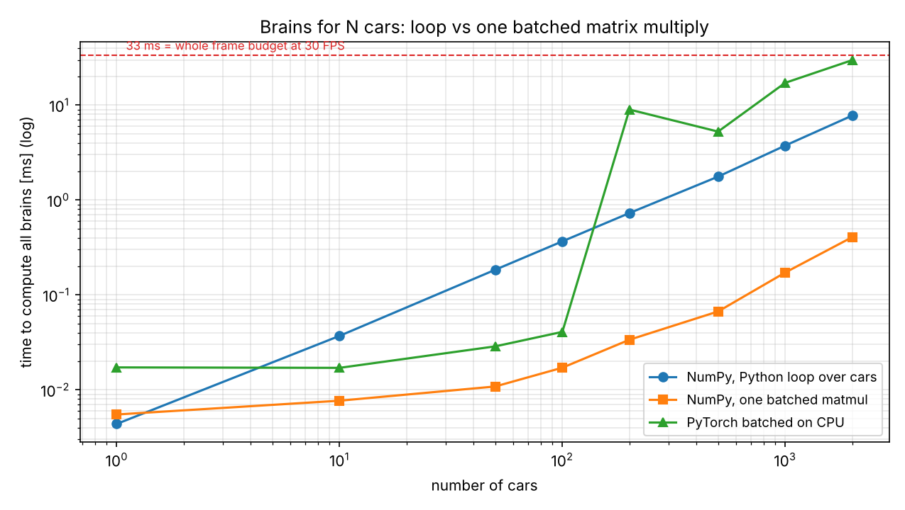
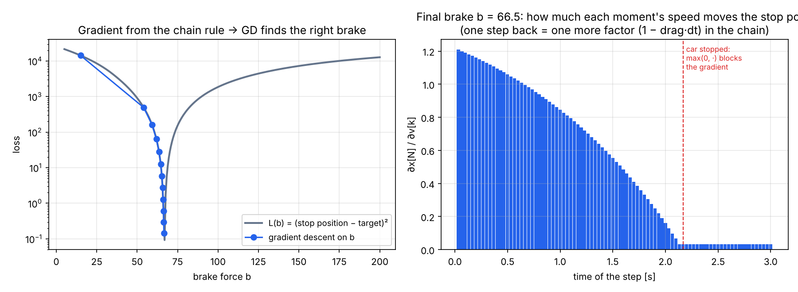
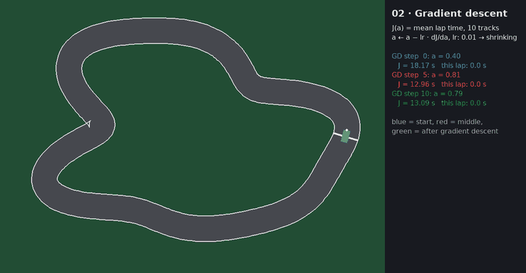
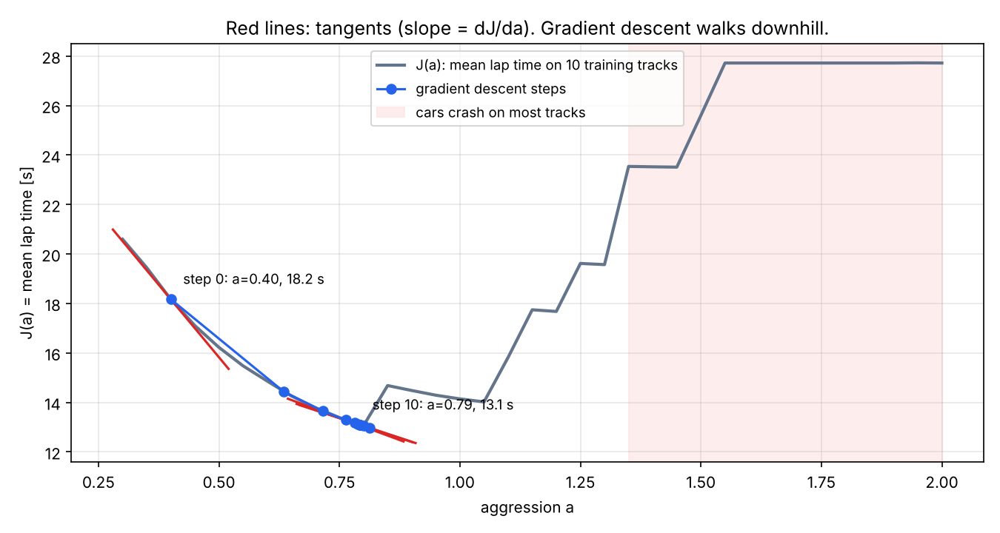
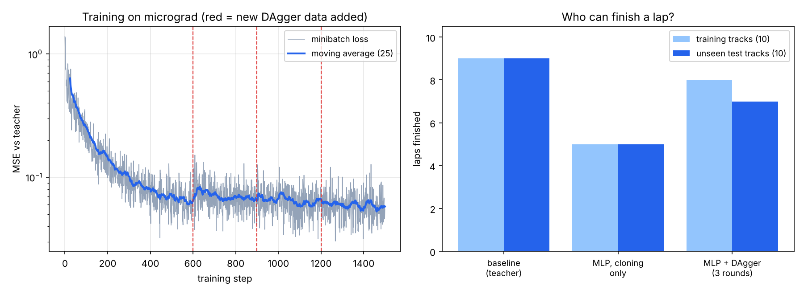

# 05 · Racing Lab: ML pojmy vysvetlené na autíčkach

🇬🇧 [English version](README.md)

Malý 2-D pretekársky simulátor v Pythone, kde sa autíčka učia prejsť trať čo najrýchlejšie. Nie je to jednorazový projekt, ale **vizuálne laboratórium, ktoré rastie spolu s roadmapou**: krok tu dostane kapitolu **vtedy, keď sa jeho pojem na autíčka prirodzene hodí**. Kroky, kde by to bolo nasilu (fine-tuning LLM, RAG, agenti), dostanú iný vizuálny príklad priamo v danom kroku. Každú si môžeš pozrieť naživo s `--watch`.


## Kapitoly

| Kap. | Krok | Čo vidíš na autíčkach | Koncept | Stav |
|---|---|---|---|---|
| [01 · Batching](#kap-01--batching-200-mozgov-v-jednom-násobení-matíc) | [01](../01-setup-benchmark/README.sk.md) | 200 áut s náhodnými mozgami, všetky v jednom násobení matíc | dávkové tenzory, CPU vs GPU, meranie času | ✅ |
| [02 · Reťazové pravidlo a gradient descent](#kap-02--reťazové-pravidlo-a-gradient-descent) | [02](../02-calculus-chain-rule/README.sk.md) | brzdiace auto sa učí zastaviť na čiare (backprop cez 90 časových krokov); 3 autá z krokov GD pretekajú | reťazové pravidlo, derivácia, gradient descent | ✅ |
| [03 · Vektory a matice](#kap-03--vektory-a-matice) | [03](../03-linear-algebra-shapes/README.sk.md) | vektor smeru auta a trate, skalárny súčin, rotačná matica, lúče | vektory, R(θ), lineárne sústavy | ✅ |
| [04 · Učenie napodobňovaním](#kap-04--neurónová-sieť-na-mojom-micrograde-sa-učí-jazdiť) | [04](../04-autograd-makemore/README.sk.md) | MLP na mojom autograde jazdí po nevidených tratiach, neuróny svietia | MLP, MSE, backprop, train/test, DAgger | ✅ |
| ďalej | kroky, kde sa to hodí | jedna kapitola za vhodný krok | pozri [plán nižšie](#ďalšie-kapitoly) | 🚧 |

## Simulátor (spoločný pre všetky kapitoly)

| Časť | Súbor | Ako funguje |
|---|---|---|
| Trate | `racing/track.py` | Uzavretá slučka: polomer = súčet sínusoviek (harmonické 2–6) s náhodnou amplitúdou. 10 tréningových tratí (seed 0–9) a 10 **nevidených testovacích** (seed 100–109). |
| Auto | `racing/car.py` | Arkádová fyzika: poloha, smer, rýchlosť. Vstupy: `steer ∈ [−1, 1]` (zatáčanie), `throttle ∈ [−1, 1]` (plyn/brzda). Všetkých N áut sa počíta naraz cez NumPy polia. |
| Senzory | `racing/car.py` | 7 lúčov od −90° po +90°. Prienik lúča so stenou je sústava 2×2 riešená Cramerovým pravidlom. Pozorovanie = 7 vzdialeností / 220 + rýchlosť / max → **8 čísel**. |
| Baseline vodič | `racing/drivers.py` | Napísaný ručne: zatáča tam, kde je viac miesta, cieľová rýchlosť úmerná voľnému miestu vpredu. Gombík `aggression`. |
| Kreslenie | `racing/render.py` | pygame: ten istý kód kreslí živé okno (`--watch`) alebo snímky do GIFu (bez okna). |

Auto vidí len 8 čísel a vracia 2. Dosť málo na to, aby sa dala pochopiť každá váha.

## Kap. 01 · Batching: 200 mozgov v jednom násobení matíc

**Krok 01 naučil:** GPU je rýchle len pri veľkých dávkach; treba merať a pred zastavením stopiek synchronizovať.

**Na autíčkach:** každé z 200 áut má vlastný mozog, MLP 8 → 16 → 2. Dá sa počítať Python cyklom cez autá, alebo jedným dávkovým násobením matíc `(N,1,8) @ (N,8,16)`. Výsledok je rovnaký (overené cez `allclose`), čas úplne iný.




| Áut | Python cyklus | Dávkové NumPy | Zrýchlenie |
|---|---|---|---|
| 10 | 0,037 ms | 0,008 ms | 5× |
| 200 | 0,73 ms | 0,034 ms | **21×** |
| 2000 | 7,8 ms | 0,41 ms | 19× |

Pri 2000 autách by cyklus zjedol štvrtinu 33 ms rozpočtu na snímku. Náhodné mozgy väčšinou nabúrajú, a to je v poriadku: zatiaľ ich nikto neučil. *(Merané v cloude, len CPU. Na Macu skript zmeria aj PyTorch na MPS.)*

## Kap. 02 · Reťazové pravidlo a gradient descent

**Krok 02 naučil:** reťazové pravidlo (backprop na `e = a·b, d = e + c, L = d²`), overené tromi spôsobmi: ručne, numericky a v PyTorchi; derivácia je sklon a gradient descent kráča z kopca dole.

### Časť A · Reťazové pravidlo na brzdiacom aute (`ch02b_chain_rule.py`)

Auto prichádza rýchlosťou 300 px/s a brzdí konštantnou silou `b`. Má zastaviť presne na bielej čiare na 250 px. Jeden krok fyziky je

```
v[k+1] = max(0, v[k] − b·dt − drag·v[k]·dt)
x[k+1] = x[k] + v[k+1]·dt
```

a loss je `L(b) = (x[N] − 250)²`. Miesto zastavenia závisí od `b` cez **90 vnorených krokov**, takže `dL/db` je dlhá reťaz: `dL/dx[N] · Σ dx[N]/dv[k] · dv[k]/db`. Je to presne graf z kroku 02, len dlhší. Skript ho počíta tými istými tromi spôsobmi:

| Gradient pri b = 15 | Hodnota |
|---|---|
| ručne (spätný cyklus cez čas, `manual_grad`) | −650,934 |
| numericky, centrálna diferencia | −650,934 |
| PyTorch autograd | −650,934 |

Všetky tri sa zhodujú v každom kroku GD. Gradient descent potom posunie `b` z 15 na **66,5** za 11 krokov; auto zastaví na 250,4 px.




Pravý graf je reťazové pravidlo v obrázku: každý krok späť v čase pridá do reťaze ďalší činiteľ `(1 − drag·dt)`, preto skorá rýchlosť ovplyvní miesto zastavenia viac. Keď auto zastane, `max(0, ·)` má deriváciu 0 a gradient zastaví: rovnako ako ReLU v sieti.

### Časť B · Gradient descent na gombíku vodiča (`ch02_gradient.py`)

**Na autíčkach:** baseline vodič má jeden parameter `a` = agresivita. Loss je `J(a)` = priemerný čas kola na 10 tréningových tratiach (nabúranie sa počíta ako 30 s). Príliš opatrný → pomalý. Príliš odvážny → búra. Deriváciu `dJ/da` odhadneme numericky a upravíme `a ← a − lr · dJ/da`.




| | a | J(a) |
|---|---|---|
| štart (krok GD 0) | 0,40 | 18,17 s |
| po 10 krokoch GD | **0,79** | **13,09 s** |

Ponaučenie: s pevným learning rate GD skákal tam a späť cez „útes nabúrania“ okolo a ≈ 0,85, kde loss nie je hladká. Pomohol zmenšujúci sa learning rate (`0,01 · 0,75^k`).

## Kap. 03 · Vektory a matice

**Krok 03 naučil:** tvary (shapes), násobenie matíc, rotácia, skalárny súčin.

**Na autíčkach:**
- modrá šípka `h = R(θ) · [1, 0]`: smer auta je rotačná matica aplikovaná na „dopredu“;
- zelená šípka `t`: smer trate;
- `h · t = cos α`: 1 znamená zarovnané s traťou, 0 znamená jazdu naprieč traťou;
- žlté lúče: každý je `R(θ + posun) · [1, 0]`, odrezaný tam, kde narazí na stenu. Ten náraz je sústava 2×2; `det = 0` znamená, že lúč je so stenou rovnobežný.


## Kap. 04 · Neurónová sieť na mojom micrograde sa učí jazdiť

**Krok 04 naučil:** autograd (`Value`, `backward()`), MLP, loss, gradient descent, rozdelenie train/val.

**Na autíčkach:** študentská sieť MLP 8 → 8 → 2 postavená z **môjho vlastného `micrograd` z kroku 04** (žiadny PyTorch) sa učí napodobniť učiteľa.
1. **Behaviour cloning (klonovanie správania):** učiteľ (baseline vodič) odjazdí 10 tréningových tratí; každá 3. snímka je príklad `(8 senzorov → zatáčanie, plyn)`. 600 krokov MSE + `backward()` + SGD.
2. **DAgger:** teraz jazdí *študent*, učiteľ povie, čo by urobil on v tých situáciách, tie príklady pridáme a trénujeme ďalej (3 kolá).
3. **Test:** obaja jazdia na 10 testovacích tratiach, ktoré nikdy nevideli.



| Vodič | Dokončené tréningové trate | Dokončené nevidené trate | Priemerné kolo (test) |
|---|---|---|---|
| Baseline (učiteľ) | 9/10 | 9/10 | 11,74 s |
| MLP, len klonovanie | 5/10 | 5/10 | 11,33 s |
| MLP + DAgger (3 kolá) | **8/10** | **7/10** | 11,54 s |

Prečo samotné klonovanie nestačí: učiteľ nerobí chyby, takže v dátach nie je ani jeden príklad typu „som príliš blízko steny, čo teraz?“. Študent spraví malú chybu, ocitne sa tam, kde učiteľ nikdy nebol, a chyby sa nabaľujú. DAgger pozbiera presne tieto situácie (1069 → 3957 príkladov). Loss na ľavom grafe pri každej červenej čiare trochu poskočí, lebo nové príklady sú ťažšie.

Chceš byť učiteľom ty? `uv run python -m chapters.play` nahrá tvoje kolá (šípky), potom `uv run python -m chapters.ch04_imitation --demos data/my_laps.npz`.

## Ďalšie kapitoly

Kapitoly pribúdajú len tam, kde autíčka naozaj pomôžu. Aktuálny plán:

| Krok (fáza) | Nápad na kapitolu |
|---|---|
| P2 · klasické ML, evaluácia | **Zovšeobecňuje to?** Všetci vodiči × train/val/test trate v jednej tabuľke; overfitting na 1 trati vs na 10 tratiach; výber podľa validácie. Plus **evolúcia**: optimalizácia bez gradientov v porovnaní s GD. |
| P3 · deep learning, CNN | **Jazda z pixelov:** namiesto lúčov malý obrázok z kamery zhora, CNN v PyTorchi na MPS, Grad-CAM ukáže, kam sa sieť pozerá. |
| po P3 · RL | **Reinforcement learning:** PPO sa učí len z odmeny (postup − nabúrania). Napodobňovanie vs evolúcia vs RL na tých istých testovacích tratiach. |
| P10 · inferencia | export vodiča do ONNX / Core ML, 1000 áut naraz, FPS pred/po, kvantizácia. |
| P11 · MLOps | každý tréning zalogovaný v MLflow; CI kontrola zlyhá, ak je nový model na testovacích tratiach pomalší. |

Kroky **bez** kapitoly na autíčkach, lebo by to bolo nasilu. Dostanú vlastný vizuálny príklad priamo v danom kroku:

| Krok | Lepší príklad ako autíčka |
|---|---|
| P4 · transformery | heatmapy attention na skutočných vetách, malý GPT generuje text po tokenoch |
| P5–P6 · fine-tuning, retrieval | odpovede modelu pred/po fine-tuningu, embeddingy dokumentov v 2-D |
| P7–P9 · RAG, agenti, evaly | ClaimPilot: ktoré úryvky sa našli a prečo, záznam krokov agenta, tabuľky skóre z evalov |
| Capstone | ClaimPilot v2 od začiatku do konca |

## Spustenie

```bash
cd 05-racing-lab
uv sync
uv run python -m chapters.ch01_batch          # benchmark + graf + GIF   (pridaj --watch pre živé okno)
uv run python -m chapters.ch02b_chain_rule    # reťazové pravidlo na brzdiacom aute, pár sekúnd
uv run python -m chapters.ch02_gradient       # ~1 min
uv run python -m chapters.ch03_vectors --watch
uv run python -m chapters.ch04_imitation      # ~1,5 min, autograd v čistom Pythone je pomalý
uv run python -m chapters.play                # jazdíš ty, nahrá data/my_laps.npz
```

## Štruktúra

```
05-racing-lab/
├── racing/          # spoločný simulátor: track.py, car.py, drivers.py, sim.py, render.py
├── chapters/        # jeden skript za krok: ch01_batch.py, ch02_gradient.py, …, play.py
├── assets/          # GIFy a grafy
└── results_ch*.json # čísla za tabuľkami
```

## Obmedzenia
- Arkádová fyzika, bez driftu a priľnavosti; cieľom je učenie, nie fyzika.
- Baseline učiteľ nie je dokonalý (9/10), takže študent ho môže nanajvýš dorovnať.
- Výsledky na 10 + 10 tratiach sú zašumené: jedna trať navyše či menej posunie „dokončené“ o 10 %.
- Čísla pre GPU (MPS) v kap. 01 sa objavia len pri spustení na Macu.
